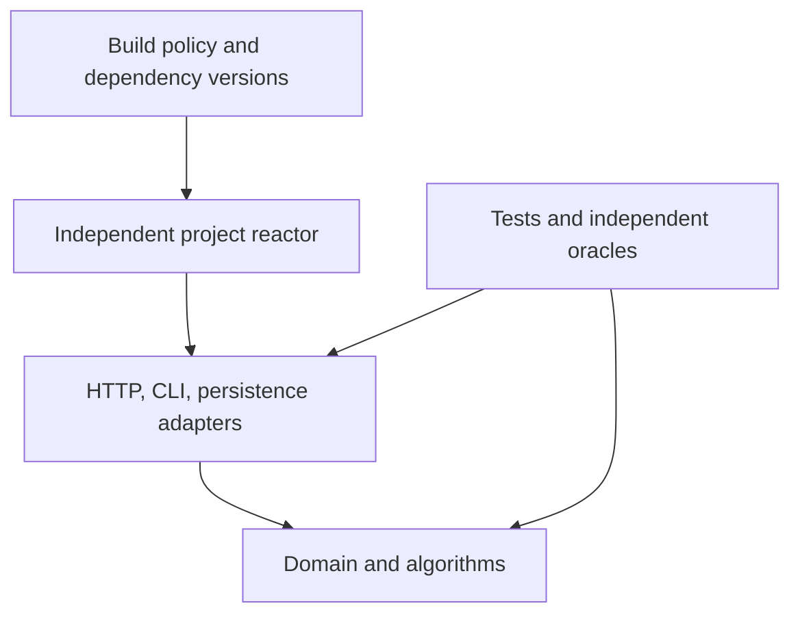

# Architecture

The repository contains ten independent Maven reactors. The root parent supplies version pins, compiler settings, formatting, test runners, and verification profiles. It contains no runtime service or shared domain model.

## Dependency boundaries

Production code must not import another project's packages or depend on its artifacts. Pure domain and algorithm modules must not depend on Spring, ORM, or JDBC APIs. `scripts/check-architecture.py` checks these boundaries and rejects artifact cycles. Project-local duplication is preferable to coupling unrelated systems through a portfolio framework.

Adapters translate external formats into validated domain values and map outcomes back to protocol responses. Persistence modules own transaction boundaries, recovery formats, and consistency guarantees. Verification modules exercise those contracts with independent oracles, synthetic fixtures, actual dependency services, and separate-process failures where required.

## State and failure

Each project owns its processes, ports, data directories, and lifecycle scripts. No shared database or service is required across projects. A service must distinguish rejection before admission, committed state, retry deduplication, and an outcome that is unknown to the caller. Recovery and cancellation semantics belong in the relevant project's invariants and operating guide.

Inputs and queues have explicit limits. Money uses checked integer arithmetic. Authentication belongs at the protocol boundary, while authorization and tenant ownership remain enforced at the state-access boundary. Local demo trust is an explicit mode with a limited threat model.

See [ADR 0001](decisions/0001-independent-projects.md) for the independence decision and each project's architecture document for its module graph and consistency model.
