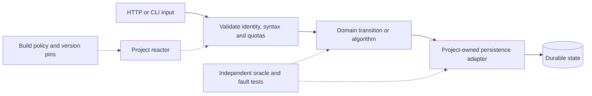

# Architecture

The repository contains ten independent Maven reactors. The root parent owns dependency versions, compiler settings and verification policy. Each project owns its domain model, adapters, data formats and operational lifecycle. There is no shared runtime framework and no cross-project production dependency.



## Where decisions live

The projects use different consistency models deliberately. Their acknowledgment and recovery contracts belong to their own implementation; a generic repository or retry abstraction would hide material differences.

| Project | Decision boundary | Durable acknowledgment or completion | Design guide |
| --- | --- | --- | --- |
| ClearLedger | Balanced journal and account/period invariants | Serializable transaction commits journal, postings, receipt and audit together | [Transaction and lock ownership](../projects/01-clearledger/docs/ARCHITECTURE.md) |
| DurableFlow | Version-pinned deterministic replay | Instance history and task/timer changes commit together; external effects have a separate uncertainty boundary | [Replay and execution](../projects/02-durableflow/docs/ARCHITECTURE.md) |
| QuorumKV | Single-owner Raft state machine | Leader acknowledgment follows the documented quorum, durable-log and application rules | [Consensus and persistence](../projects/03-quorumkv/docs/ARCHITECTURE.md) |
| PulseStream | Event-time transitions and partition ownership | SQL state, source position and outbox changes share a transaction; Kafka delivery remains retryable | [Watermarks and recovery](../projects/04-pulsestream/docs/ARCHITECTURE.md) |
| TenantShield | Bounded policy evaluation over an authorized snapshot | Published versions and tenant-scoped data define the decision snapshot | [Policy and tenant boundaries](../projects/05-tenantshield/docs/ARCHITECTURE.md) |
| MatchCore | Serialized price/time matching and risk reservations | Forced journal and deterministic replay define command durability | [Command ownership](../projects/06-matchcore/docs/ARCHITECTURE.md) |
| IndexForge | Authorized retrieval from immutable generations | Generation commit and pointer publication define visibility; readers hold generation leases | [Ingestion and publication](../projects/07-indexforge/docs/ARCHITECTURE.md) |
| ThreadLens | Bounded observation outside the host application's semantics | Completed reports declare observation coverage and losses; samples do not establish causality | [Collection and instrumentation](../projects/08-threadlens/docs/ARCHITECTURE.md) |
| ByteGuard | Bounded abstract interpretation of class files | Reports distinguish complete analysis from exhausted budgets; target classes are never executed | [Analysis and coverage](../projects/09-byteguard/docs/ARCHITECTURE.md) |
| RouteWeaver | Independent validation before incumbent publication | Durable job fencing and version checks precede publication of an immutable plan | [Planning and publication](../projects/10-routeweaver/docs/ARCHITECTURE.md) |

## Dependency boundaries

Adapters translate external formats into validated values and map domain outcomes to protocol responses. Persistence adapters own transaction boundaries, recovery formats and storage failure handling. Algorithm modules express the decision independently of Spring, JDBC and ORM APIs. Verification modules contain independent models, synthetic fixtures and real service/process failure tests.

[`check-architecture.py`](../scripts/check-architecture.py) enforces project-local production imports, declared artifact dependencies and acyclic module graphs, including dependencies declared inside profiles. Its compiled mode inspects type references with the pinned JDK's `jdeps`, catching fully qualified uses that an import scan cannot see:

```bash
# Build first; the check rejects missing compiled production classes.
python3 scripts/check-architecture.py --bytecode matchcore
```

CI runs this check after each ordinary project build. It is a static type/dependency boundary check, not a proof about reflection, dynamically loaded classes or arbitrary runtime configuration. Project-local duplication is preferable to coupling unrelated systems through a portfolio utility framework.

## State, ownership and failure

Every mutating adapter must answer four questions: what validates admission, who serializes conflicting transitions, what durable event authorizes success, and how a caller recovers after losing the response. A network timeout or failed connection close cannot establish that a transaction rolled back. Retry decisions must use operation identity, durable receipts or fencing rather than an assumption that nothing happened.

Asynchronous work needs an explicit owner. Accepted tasks, scheduled heartbeats, sockets, generation readers and child processes must remain owned through shutdown. Closing admission comes before draining accepted work; storage and lease maintenance remain available while outcomes are recorded. A bounded shutdown can still leave an unknown external outcome, which must remain visible in durable state and operator guidance.

Inputs, expansion, queues, caches, concurrent work and elapsed execution have separate limits. Their budgets must compose: an HTTP request limit must admit every supported serialized domain value, and a writer must not produce records that its reader rejects. Tenant authorization applies at every observable boundary, including counts, metrics, caches, suggestions, diagnostics and failure responses.

## Verification and change compatibility

Tests target observable contracts: concurrent lock schedules, acknowledged state after restart, migration from prior formats, corruption refusal, cancellation races and resource cleanup. Independent oracles check domain results without invoking the implementation being checked. A mutation percentage applies only to its declared targets; timeout is not a confirmed kill.

Persisted histories, receipts and storage formats are compatibility boundaries. Compatible migrations add validation or metadata without rewriting prior identifiers and outcomes. Frozen interpreters remain available for their pinned histories. Each project's invariants and operating guide identify the exact recovery assumptions and unsupported operations.

[ADR 0001](decisions/0001-independent-projects.md) records the independence decision. The [development guide](development.md) explains the executable checks; the [release criteria](release.md) distinguish correctness, security, performance and operational evidence.
