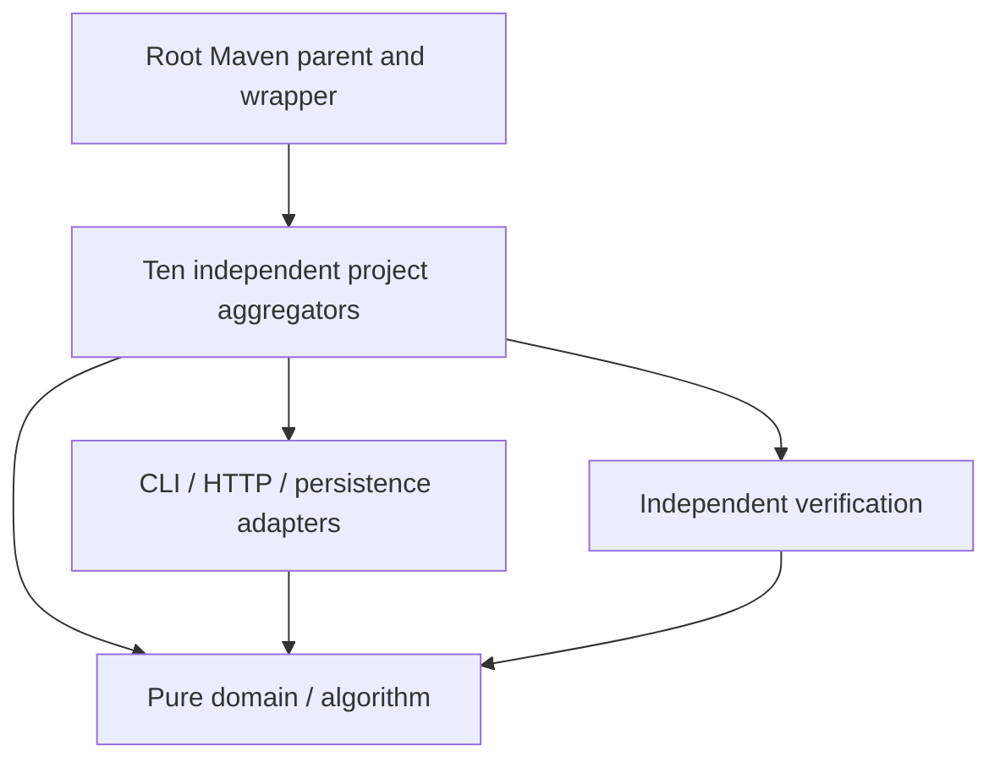

# Independent-project architecture

The root POM shares build policy and dependency versions only. Each project is independently buildable and owns its domain, adapters, persistence and verification. Production imports across projects are prohibited. Domain/algorithm artifacts must not depend on Spring. Runtime processes and data directories are project scoped; no shared database or service is required.

