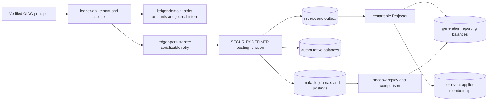

# Architecture

The domain has no Spring/JDBC annotations or dependencies. The API authenticates issuer, signature, audience, expiry, tenant claim and required scope before using the tenant identifier. JDBC owns complete serializable transactions and bounded retries. It passes parameters to schema-qualified SQL functions; runtime cannot update/delete posted journals, postings, accounts or authoritative balances.

Storage relationships use composite `(tenant_id,id)` keys. Tenant→account/period; period→journal; journal→posting/receipt/outbox; import→row→match/decision. A match's candidate posting is consumed at most once. A reversal references its immutable original and is unique per original.

Each posting locks its period, then participating accounts sorted by UUID. Period closure updates the same period row. One period lock intentionally serializes writers inside that period; this conservative boundary favors reviewable correctness over maximal intra-tenant throughput. Retry includes every read and decision and has no network side effects. See ADR001.

Reporting uses `(generation,event_id)` membership rather than a sequence maximum. Each event's deltas and applied membership commit together. Shadow replay populates a new generation, verifies both-direction set equality against authoritative balances under an outbox table fence, then changes the active generation. New events can make promotion fail safely; rerun with a new generation. Prior generations remain available for inspection. See ADR002.

Statements sort `(effective_date,journal_id,line_no)` with keyset cursors. `snapshot` is PostgreSQL's transaction visibility snapshot, applied to each immutable journal's xid8 recording transaction. It excludes transactions that were in progress at first-page visibility, including later-committing lower IDs. Reuse snapshot, boundary and filters on subsequent pages. Recorded date is an additional explicit upper bound. No offset pagination or unsafe MAX journal watermark is used.
