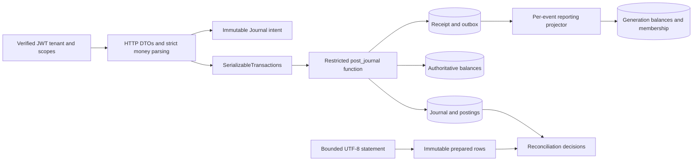

# Architecture and transaction boundaries

Daybook treats a posted journal as immutable source. PostgreSQL commits the journal, its lines, authoritative debit/credit totals, idempotency receipt, and reporting event together. HTTP is an adapter to that boundary; reporting and reconciliation never replace it.



## Modules and source map

| Module | Production responsibilities |
| --- | --- |
| `ledger-domain` | [Money](../ledger-domain/src/main/java/io/github/cheshmakzanoon/portfolio/daybook/Money.java) defines currency scales and exact minor-unit bounds. [Journal](../ledger-domain/src/main/java/io/github/cheshmakzanoon/portfolio/daybook/Journal.java) validates immutable balanced intent and computes its retained digest. [LedgerText](../ledger-domain/src/main/java/io/github/cheshmakzanoon/portfolio/daybook/LedgerText.java) enforces lossless PostgreSQL text; [ReferenceLedger](../ledger-domain/src/main/java/io/github/cheshmakzanoon/portfolio/daybook/ReferenceLedger.java) independently accumulates debit/credit totals for fixtures. There are no Spring or JDBC dependencies. |
| `ledger-persistence` | [LedgerStore](../ledger-persistence/src/main/java/io/github/cheshmakzanoon/portfolio/daybook/LedgerStore.java) exposes posting, reversal, period, receipt, and statement queries. [SerializableTransactions](../ledger-persistence/src/main/java/io/github/cheshmakzanoon/portfolio/daybook/SerializableTransactions.java) owns connection/commit/retry outcomes; [RetryBackoff](../ledger-persistence/src/main/java/io/github/cheshmakzanoon/portfolio/daybook/RetryBackoff.java) supplies bounded jitter. [Projector](../ledger-persistence/src/main/java/io/github/cheshmakzanoon/portfolio/daybook/Projector.java) owns reporting membership/generations. [StatementCsv](../ledger-persistence/src/main/java/io/github/cheshmakzanoon/portfolio/daybook/StatementCsv.java) prepares immutable imports and formats contract-ordered exports; [Reconciliation](../ledger-persistence/src/main/java/io/github/cheshmakzanoon/portfolio/daybook/Reconciliation.java) owns transactional matching and decisions. |
| `ledger-api` | [DaybookApplication](../ledger-api/src/main/java/io/github/cheshmakzanoon/portfolio/daybook/DaybookApplication.java) wires strict JSON, data access, and scope rules. [StrictIdentityDecoder](../ledger-api/src/main/java/io/github/cheshmakzanoon/portfolio/daybook/StrictIdentityDecoder.java) preserves original signed claim types. [RequestBoundsFilter](../ledger-api/src/main/java/io/github/cheshmakzanoon/portfolio/daybook/RequestBoundsFilter.java) bounds actual bodies and nesting. [LedgerController](../ledger-api/src/main/java/io/github/cheshmakzanoon/portfolio/daybook/LedgerController.java) maps requests and known validation failures to the HTTP contract. |
| `ledger-verification` | [CrashWriter](../ledger-verification/src/main/java/io/github/cheshmakzanoon/portfolio/daybook/CrashWriter.java) exposes a verification-only process boundary. [SourceAudit](../ledger-verification/src/main/java/io/github/cheshmakzanoon/portfolio/daybook/SourceAudit.java) executes the shared immutable-source audit. [Workload](../ledger-verification/src/main/java/io/github/cheshmakzanoon/portfolio/daybook/Workload.java) generates seeded closed-loop writes and independent expected balances. These tools are not application endpoints. |
| `ledger-benchmarks` | [AccountingBenchmark](../ledger-benchmarks/src/main/java/io/github/cheshmakzanoon/portfolio/daybook/AccountingBenchmark.java) measures exact parsing and digest CPU work; it excludes HTTP and PostgreSQL and is enabled through the optional benchmark profile. |

## Posting and reversal

The verified principal supplies the tenant; request bodies cannot select it. The adapter constructs a `Journal` only after strict decimal parsing. An immutable journal contains its period, effective date, currency, reference, and 2–100 positive bounded lines. Its digest sorts line encodings, preserving multiplicity while ignoring presentation order. Valid references round-trip through UTF-8; malformed surrogates and NUL are rejected rather than silently changing canonical intent.

```mermaid
sequenceDiagram
  participant Client
  participant API as LedgerController
  participant TX as SerializableTransactions
  participant DB as post_journal
  Client->>API: POST journal + retained key
  API->>API: Verify tenant/scope; construct Journal
  API->>TX: Complete SQL callback
  TX->>DB: BEGIN SERIALIZABLE; post_journal(...)
  DB->>DB: Validate operation identity; look up receipt
  alt Matching retained receipt
    DB-->>TX: Original journal ID
  else New operation
    DB->>DB: Lock period, UUID-ordered accounts, optional original journal
    DB->>DB: Validate and insert source, balances, receipt, outbox
    DB-->>TX: New journal ID
  end
  TX->>DB: COMMIT; deferred invariant backstop
  TX-->>API: Acknowledged result
  API-->>Client: Stable journal ID
```

The current SQL definition is [V3](../ledger-persistence/src/main/resources/db/migration/V3__validated_posting_operation.sql). [V1](../ledger-persistence/src/main/resources/db/migration/V1__ledger.sql) and [V2](../ledger-persistence/src/main/resources/db/migration/V2__null_safe_posting_and_deferred_audit.sql) remain immutable migration history. V3 changes validation and adds an operation constraint without rewriting source rows, receipt digests, or grants.

A new posting locks the accounting-period row, then participating accounts in UUID order. A reversal additionally locks the referenced journal after those locks and checks an exact side-swapped multiset with `EXCEPT ALL`. Period closure updates the same period row. The unique reversal reference prevents a second reversal of the same target. The HTTP reversal operation retains the target's period, so its supplied date must lie in that still-open period; posting an adjustment in another period is a separate journal operation.

The runtime role cannot write source journals, lines, or balances directly. Its SQL function capability remains trusted application infrastructure: the Java domain computes the canonical digest; SQL validates the supplied identity and enforces storage invariants. A DBA or stolen application database credential is outside the tenant-user threat model.

## Transaction outcomes and resource ownership

```mermaid
stateDiagram-v2
  [*] --> Attempt
  Attempt --> Work: acquire connection and set SERIALIZABLE/budgets
  Work --> Commit: complete callback succeeds
  Work --> Rollback: rejection or failure
  Commit --> Confirmed: commit returns normally
  Commit --> Rollback: commit throws
  Confirmed --> Result: close connection; retain acknowledged result
  Rollback --> Retry: known serialization/deadlock/lock/uniqueness race
  Retry --> Attempt: close before bounded jitter; attempts remain
  Rollback --> Failure: permanent, unknown connection outcome, or exhausted budget
  Result --> [*]
  Failure --> [*]
```



The executor retries the **entire** callback, including decisions and reads. Callbacks must contain no external effects. Twelve database attempts and eleven jittered pauses are the maximum; connection checkout, SQL, and lock waits are additional time. A network error during commit is an unknown outcome and is returned for same-key recovery, not automatically replayed. A pool-close error after commit was acknowledged cannot undo that commit and cannot trigger a second execution. Rollback/close diagnostics do not replace the primary failure. A canceled thread acquires no new connection.

The pool defaults to 32 connections, a 15-second checkout timeout, a 15-second SQL statement timeout, and a 10-second lock timeout. These are individual budgets, not a 15-second end-to-end API guarantee. See [operations](OPERATIONS.md) for retry and recovery examples.

## Reporting membership and promotion

Every applied event inserts `(generation,event_id)` membership and updates reporting totals in one transaction. `ON CONFLICT DO NOTHING` plus complete serializable retry makes concurrent projectors converge on one application per event. A sequence maximum is never used as a commit-order watermark: an earlier allocated event can commit later.

Replay builds a new generation, drains visible source events, and invokes `promote_shadow`. Promotion takes a source outbox table fence, compares debit and credit totals in both directions against authoritative balances in its transaction snapshot, and switches the generation pointer only after equality. A mismatch preserves the active pointer. Concurrent source commits can leave pending events; reporting always exposes generation and tenant-scoped freshness and must not be presented as authoritative current balances.

## Reconciliation and statement views

CSV decoding, row bounds, exact amounts, duplicate source identities, and content hashing run once before a connection is acquired. `StatementCsv.Prepared` owns immutable rows, so a transaction retry repeats database decisions against the same parsed input. A tenant/content-hash uniqueness constraint stabilizes repeated imports.

Automatic matching requires one unconsumed posting with the exact reference, currency, and signed amount. Zero candidates remain unmatched; multiple candidates require review. Manual decisions lock the source row, recheck currency/amount and candidate availability, then atomically reserve the posting, append actor/reason/evidence, and change row status. Unique constraints prevent both double source-row use and double candidate use. A losing concurrent decision rereads current state and rejects rather than consuming the same posting again.

Statements use `(effective_date,journal_id,line_no)` keyset pagination. The first response supplies a PostgreSQL transaction-visibility snapshot and recording-time boundary. Subsequent pages must reuse both plus the final row cursor. Filtering each immutable journal's `recorded_xid` excludes transactions that were still in progress at the first visibility snapshot, including later-committing lower IDs. The summary uses the same source filters; reporting projections do not participate.

## Local resource ownership

[Startup](../scripts/up.sh) snapshots all/running Compose container IDs and acquires a lifecycle file lock. Failure rollback preserves earlier running resources, re-stops previously stopped containers started during the attempt, removes only new containers, and never clears volumes. Successful migrations are retained data; resource rollback does not undo an already committed schema change.

[Process ownership](../scripts/runtime-process.py) binds a launch record to boot ID, kernel start ticks, executable, exact JAR path, and launch SHA256. Reuse additionally requires current JAR bytes; stopping the original recorded JVM remains permitted after a build changes the artifact. PID descriptors avoid a check-to-signal PID-reuse race when available. [Shutdown](../scripts/down.sh) waits for termination before removing the record and completes scoped Compose cleanup while retaining the primary exit status. [Lifecycle regressions](../scripts/test-lifecycle.py) use real processes and a controlled Compose/readiness adapter.

Executable identity is mandatory when publishing a new process record. If a managed procfs later denies only executable dereference with `EACCES`/`EPERM`, boot/start identity and the hash of every exact command argument remain mandatory; a readable executable must still match. Other read failures refuse ownership. Two kernel-stat reads bracket the argument/executable observation, and a changed kernel start identity refuses control. Argument hashes avoid retaining command configuration or secrets in the record.
