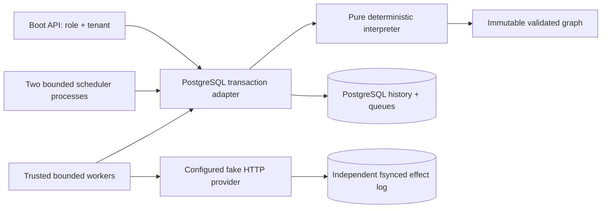

# Architecture

`workflow-model` owns a finite typed DAG (128 nodes; 16 dependencies and downstream children). A definition has exactly one root and no cycles. Its canonical record representation is SHA-256 hashed. Version/name conflicts never replace content. Expressions are parsed whitelist equalities (`input.approved==true`) and branch guards (`choice==true`); no executable expression engine exists. `PARALLEL_ALL` is an explicit bounded join over predecessor nodes. Independent enabled DAG children run concurrently.

`workflow-engine` replays validated definitions, typed events and immutable input. All times enter as recorded event instants. A task's logical identity is its node ID within its instance; compensation uses a separate reserved `comp-` identity namespace. Pure branches and joins consume recorded inputs and completed predecessor values without external calls. New definitions pin semantics `3`: scalar TEXT/INTEGER/BOOLEAN payloads retain their actual JSON types, exact context schemas are checked before writes, and activity arguments come from predecessor outputs. An explicit join flattens VALUE vectors in definition order; SKIPPED branches contribute no values, and TIMED_OUT propagates until an explicit status predicate handles it. Frozen semantics `1` and `2` adapters retain original String and prior typed histories without rewriting them. Semantics3 cancellation records the current forward-lease count as a typed INTEGER input so terminal-failure rejection preserves legitimate late completion. Unsupported semantics are rejected.

`workflow-persistence` uses READ COMMITTED transactions, instance row locks, explicit expected-version compare-and-set, monotonic instance versions, `(instance_id,sequence)` history uniqueness and `(instance_id,logical_id)` task uniqueness. Each command locks the tenant-scoped instance before mutating task rows. Start additionally uses a tenant advisory lock to serialize request-key insertion and quota checking. Claims lock bounded instance batches before task `FOR UPDATE SKIP LOCKED` rows; an empty claim is never evidence of global termination. Completion and dispatch verify instance, task, attempt, worker, generation, credential, safety, parameters and unexpired database-time lease. All queries use bound SQL parameters and 15-second statement budgets.

The scheduler scans indexed timer/lease records in bounded batches. Dormant timers allocate no Java threads. Database clock changes affect deadline latency; they do not alter replayed instants or event ordering. An expired lease permits reassignment only for repeatable work or undispatched work. An expired dispatched non-idempotent task becomes `UNKNOWN_OUTCOME`, materializing workflow `MANUAL_REVIEW`. Unrelated ready work remains paused by workflow state until reconciliation.

Cancellation blocks new dispatch, cancels queued work and timers, and waits for outstanding forward leases to settle before choosing undo. A worker already authorized to call a provider might still perform its effect after cancellation. Completed compensable steps create obligations. Undo is serialized in reverse recorded completion order, including parallel completions; this assumes business compensations can undo each step in that order and that the domain has no unmodeled causal dependency. Each undo has a stable, distinct provider key. Exhausted undo is visible as `COMPENSATION_FAILED`; an operator can authorize another bounded retry window.

State progression is derived from history: active ready work → RUNNING; only timers/signals → WAITING; all graph nodes settled → COMPLETED; cooperative cancellation with leases pending → CANCEL_REQUESTED; undo pending → COMPENSATING; undo exhausted → COMPENSATION_FAILED; uncertainty → MANUAL_REVIEW; successful full cancellation/undo → CANCELLED; failed forward work after undo → FAILED. Terminal execution cancellation is rejected.

Workers use four bounded activity slots, a four-element queue, a fixed heartbeat scheduler and virtual blocking I/O workers. They call only compiled registry activities and one configured provider URI with redirects disabled. The provider logs calls and actual effects separately, fsyncs effects before responding and reconstructs its idempotency map on restart.
