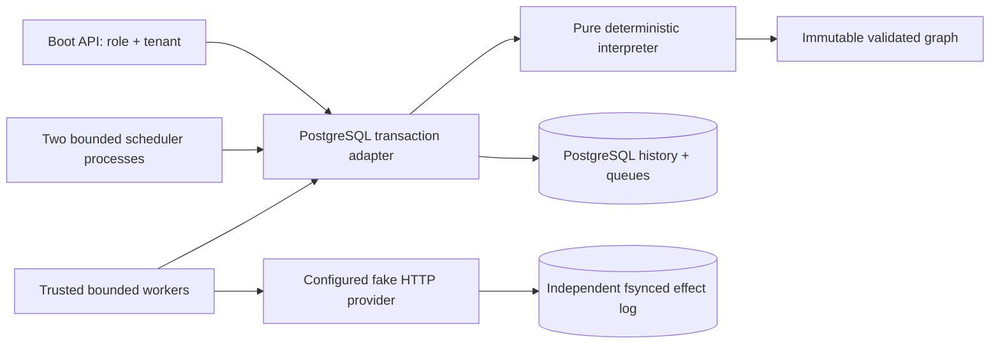
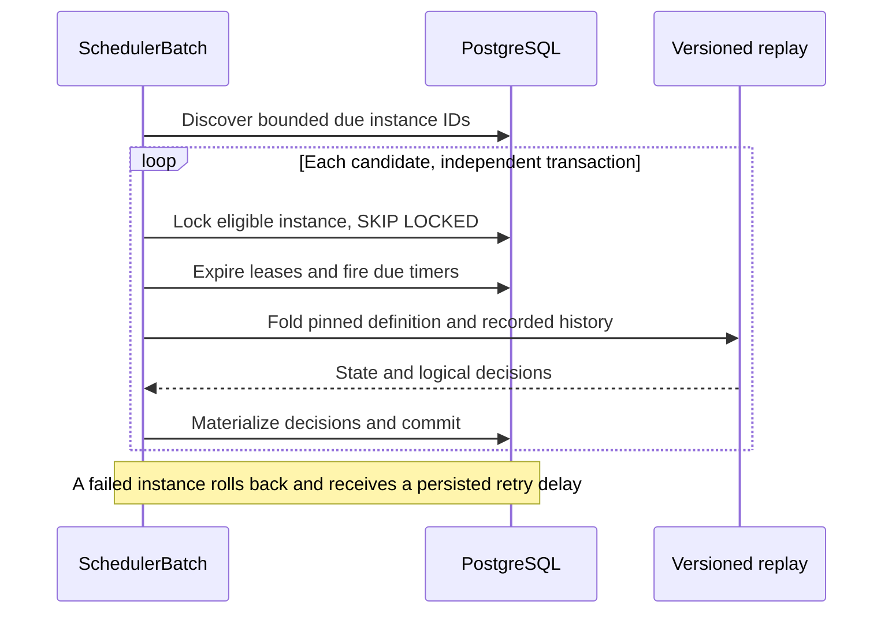
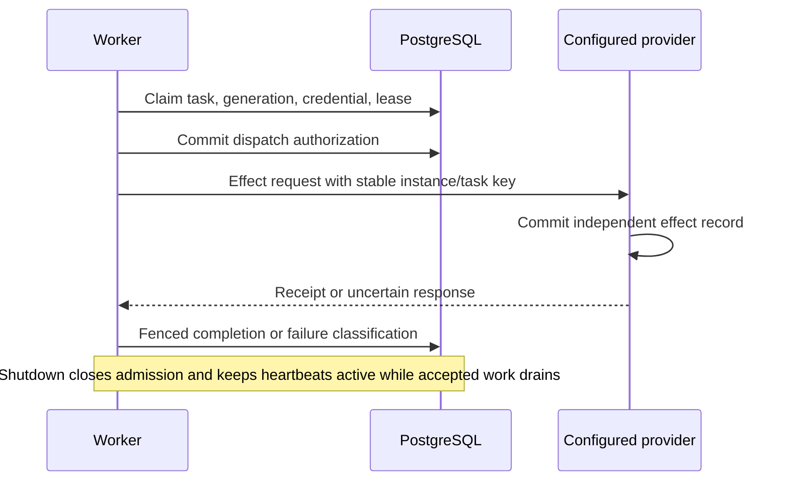
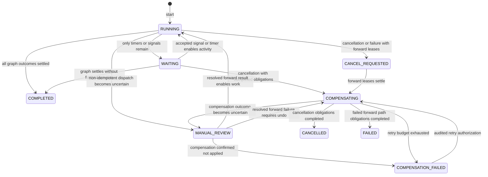

# Architecture

`workflow-model` owns a finite typed DAG (128 nodes; 16 dependencies and downstream children). A definition has exactly one root and no cycles. Its canonical record representation is SHA-256 hashed. Version/name conflicts never replace content. Expressions are parsed whitelist equalities (`input.approved==true`) and branch guards (`choice==true`); no executable expression engine exists. `PARALLEL_ALL` is an explicit bounded join over predecessor nodes. Independent enabled DAG children run concurrently.

`workflow-engine` replays validated definitions, typed events and immutable input. All times enter as recorded event instants. A task's logical identity is its node ID within its instance; compensation uses a separate reserved `comp-` identity namespace. Pure branches and joins consume recorded inputs and completed predecessor values without external calls. New definitions pin semantics `3`: scalar TEXT/INTEGER/BOOLEAN payloads retain their actual JSON types, exact context schemas are checked before writes, and activity arguments come from predecessor outputs. An explicit join flattens VALUE vectors in definition order; SKIPPED branches contribute no values, and TIMED_OUT propagates until an explicit status predicate handles it. Frozen semantics `1` and `2` adapters retain original String and prior typed histories without rewriting them. Semantics3 cancellation records the current forward-lease count as a typed INTEGER input so terminal-failure rejection preserves legitimate late completion. Unsupported semantics are rejected.

`workflow-persistence` uses READ COMMITTED transactions, instance row locks, explicit expected-version compare-and-set, monotonic instance versions, `(instance_id,sequence)` history uniqueness and `(instance_id,logical_id)` task uniqueness. Each command locks the tenant-scoped instance before mutating task rows. Start additionally uses a tenant advisory lock to serialize request-key insertion and quota checking. Claims lock bounded instance batches before task `FOR UPDATE SKIP LOCKED` rows; an empty claim is never evidence of global termination. Completion and dispatch verify instance, task, attempt, worker, generation, credential, safety, parameters and unexpired database-time lease. All queries use bound SQL parameters and 15-second statement budgets.

The compatible worker protocol echoes the complete issued `Claim`. A task input contains the original execution input, flattened activity arguments, and predecessor outcomes; it is therefore larger than an execution start. [WorkflowLimits](../workflow-model/src/main/java/io/github/cheshmakzanoon/portfolio/handoff/WorkflowLimits.java) caps the persisted serialization at 256 KiB. Only dispatch, heartbeat, completion, and failure accept a 528 KiB body: twice the task budget for JSON string escaping, plus 16 KiB for bounded metadata and results. Public commands and worker claim requests retain an 8 KiB cap. Worker-supplied parameters are compared with the stored lease; they are never trusted as an independent execution instruction. The provider receives raw task JSON prefixed by its compiled activity name and a colon; its separate request limit derives from that byte budget and the actual registry's longest name.

The scheduler scans indexed timer/lease records in bounded batches. Dormant timers allocate no Java threads. Database clock changes affect deadline latency; they do not alter replayed instants or event ordering. An expired lease permits reassignment only for repeatable work or undispatched work. An expired dispatched non-idempotent task becomes `UNKNOWN_OUTCOME`, materializing workflow `MANUAL_REVIEW`. Unrelated ready work remains paused by workflow state until reconciliation.

Cancellation blocks new dispatch, cancels queued work and timers, and waits for outstanding forward leases to settle before choosing undo. A worker already authorized to call a provider might still perform its effect after cancellation. Completed compensable steps create obligations. Undo is serialized in reverse recorded completion order, including parallel completions; this assumes business compensations can undo each step in that order and that the domain has no unmodeled causal dependency. Each undo has a stable, distinct provider key. Exhausted undo is visible as `COMPENSATION_FAILED`; an operator can authorize another bounded retry window.

State progression is derived from history: active ready work → RUNNING; only timers/signals → WAITING; all graph nodes settled → COMPLETED; cooperative cancellation with leases pending → CANCEL_REQUESTED; undo pending → COMPENSATING; undo exhausted → COMPENSATION_FAILED; uncertainty → MANUAL_REVIEW; successful full cancellation/undo → CANCELLED; failed forward work after undo → FAILED. Terminal execution cancellation is rejected.

Workers use four bounded activity slots, a four-element queue, a fixed heartbeat scheduler and virtual blocking I/O workers. They call only compiled registry activities and one configured provider URI. A dedicated transport validates the endpoint, caps response bytes before buffering, rejects malformed UTF-8, and treats redirects and generic HTTP errors as uncertain outcomes. Automatic non-idempotent retry requires the configured provider's explicit `503` / `X-Effect-Outcome: NOT_APPLIED` refusal contract. Neither redirects nor caller-supplied URLs can change the destination. The provider logs calls and actual effects separately, fsyncs effects before responding and reconstructs its idempotency map on restart.

[ADR 004](DECISIONS/004-provider-outcome-contract.md) specifies the provider response contract and why an HTTP error alone cannot authorize a non-idempotent retry.

## Transaction and scheduling responsibilities

The public [WorkflowStore](../workflow-persistence/src/main/java/io/github/cheshmakzanoon/portfolio/handoff/WorkflowStore.java) owns the application commands and their instance lock boundaries. Its collaborators have narrower responsibilities:

| Component | Responsibility |
| --- | --- |
| [JdbcTransactions](../workflow-persistence/src/main/java/io/github/cheshmakzanoon/portfolio/handoff/JdbcTransactions.java) | Own a READ COMMITTED connection, commit/rollback, and preserve the primary failure when rollback or close also fails |
| [PersistenceFailure](../workflow-persistence/src/main/java/io/github/cheshmakzanoon/portfolio/handoff/PersistenceFailure.java) | Distinguish recoverable connection/transaction failures from terminal SQL contracts before a runtime loop retries |
| [WorkflowHistory](../workflow-persistence/src/main/java/io/github/cheshmakzanoon/portfolio/handoff/WorkflowHistory.java) | Preserve contiguous sequence/version checks, typed event serialization, and history/text size limits inside the existing instance transaction |
| [WorkflowSql](../workflow-persistence/src/main/java/io/github/cheshmakzanoon/portfolio/handoff/WorkflowSql.java) | Parameterized statements with a common query budget |
| [WorkflowReplay](../workflow-persistence/src/main/java/io/github/cheshmakzanoon/portfolio/handoff/WorkflowReplay.java) | Decode pinned inputs and adapt frozen semantics 1/2 results to the current read model |
| [ActivityFailure](../workflow-persistence/src/main/java/io/github/cheshmakzanoon/portfolio/handoff/ActivityFailure.java) | Decide retry, terminal failure, or uncertainty without performing I/O |
| [SchedulerBatch](../workflow-persistence/src/main/java/io/github/cheshmakzanoon/portfolio/handoff/SchedulerBatch.java) | Discover due instances and acquire one independent, nonblocking instance transaction at a time |

A scheduler batch is not an atomic business operation. Each execution is its own serialization boundary. One full or rejected history must not undo another execution's timer firing. Discovery therefore retains no row locks; processing rechecks eligibility under `FOR UPDATE SKIP LOCKED`, expires that instance's work, replays, schedules, and commits together.

A rejected instance transition rolls back before a separate transaction records its five-second scheduling deferral and failure counter. That update compares the version captured under the failed transaction's instance lock: a command that advanced history after rollback cannot inherit stale failure metadata. [Migration V3](../workflow-persistence/src/main/resources/db/migration/V3__scheduler_failure_isolation.sql) adds this retry-admission metadata without changing definition hashes, interpreter pins, or existing history. Deferred instances are temporarily excluded from worker claims and scheduler discovery, allowing later pages to progress. Success clears the current error, retaining the cumulative counter. SQL failures propagate out of the batch, including failures after its instance lock: runtime loops retry known recoverable failures, while schema, integrity, and configuration errors terminate visibly rather than becoming per-instance domain errors.

## External effect and shutdown sequence

[Worker](../workflow-worker-sdk/src/main/java/io/github/cheshmakzanoon/portfolio/handoff/Worker.java) closes admission before draining accepted tasks for up to 15 seconds, followed by a bounded interruption window. Lease heartbeats remain active during the graceful phase. The provider client closes after task outcomes have had a chance to commit. A caller's interrupt flag is restored after cleanup. A claim that returns after admission closes is released through the existing bounded failure path without dispatching an external call.

A known recoverable storage failure while acquiring a claim is retried with interruptible delays of 100, 200, 400, 800, then at most 1,000 ms. A successful acquisition resets the delay. Retry classification recognizes SQL connection/transaction/resource classes, explicit server shutdown and query-timeout states, and unclassified JDBC transient/recoverable or transport timeout/connect exceptions. An explicit terminal SQLState takes precedence over nested transport symptoms. No speculative claim enters the activity pool; a lost commit acknowledgement leaves any committed lease to normal expiry. Invalid worker identity, terminal SQL errors, and other contract failures remain visible terminal errors. Shutdown interrupts claim backoff through the same owner thread path as normal polling. The scheduler uses the same classifier with a one-second retry delay.

[RuntimeMain](../workflow-worker-sdk/src/main/java/io/github/cheshmakzanoon/portfolio/handoff/RuntimeMain.java) owns the store with try-with-resources. Its shutdown hook interrupts the owner and allows up to 30 seconds for normal resource cleanup. Forced termination can still leave a dispatched call uncertain; database-time lease expiry and provider reconciliation remain the recovery mechanism.

Current replay additionally validates that every compensation event belongs to the next reverse-completion obligation. A correct next decision is insufficient if a later history entry can claim an older compensation completed first. Frozen semantics 1 and 2 remain unchanged; valid histories produced by the existing serialized compensation path retain their behavior.

## Domain-state overview

The diagram shows the principal paths. Immediate cancellation/failure without obligations can terminate directly; a resolved final result can complete the graph. Scheduling deferral is runtime admission metadata, not another domain state or a rewrite of recorded business history.

## Read-only inspection and bounded history pages

`WorkflowInspection` owns viewer operations. `JdbcTransactions.inspect` starts a
PostgreSQL **read-only, repeatable-read transaction** before selecting the
tenant-scoped instance header. Definition, version, committed state, and history
therefore belong to one database snapshot even when a worker commits between
queries. Ordinary mutation transactions retain their existing read-committed
isolation and instance-lock discipline.

The execution view runs only the pure replay adapter to derive values. It returns
the committed runtime state, which includes outstanding-lease cancellation
barriers absent from the pure interpreter's inputs. It does not call `schedule`,
create tasks, update runtime state, or execute the mutation commit hook. A viewer
does not repair administrator-corrupted scheduling rows. Writers and schedulers
remain the only paths that apply workflow decisions.

The existing full-history operation retains its array response. Both history
operations read with indexed `(instance_id, sequence)` bounds and no `FOR UPDATE`
lock. The page operation selects at most 200 events; its first request captures
the current instance version. Later requests use that version as an immutable
upper bound and use the final returned sequence as their exclusive lower bound.
No server-side cursor or long-lived transaction survives between HTTP requests.

An explicitly requested historical version is valid only within the retained
positive prefix of the authenticated execution. The cursor carries no authority;
every page rechecks tenant ownership. A missing execution and an execution owned
by another tenant both fail lookup. Events must be contiguous and match the
expected count within the selected range. Missing persisted rows are an integrity
failure, rather than a successful empty final page. The page record copies its
event list and validates that its cursor and `hasMore` agree with its contents.

These changes require no schema or interpreter-semantic migration. Existing
semantics 1/2 replay adapters and semantics 3 history formats are unchanged. The
read-only transaction prevents accidental SQL writes even if a future inspection
implementation incorrectly tries to issue one; integration tests exercise that
database enforcement and hold a real writer lock while all viewer operations
finish.
