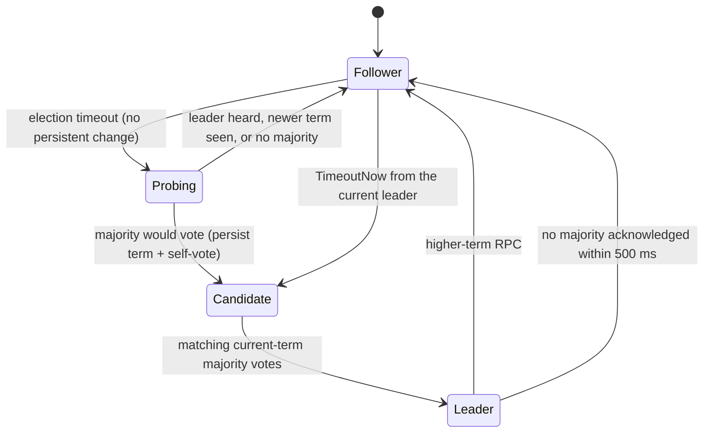
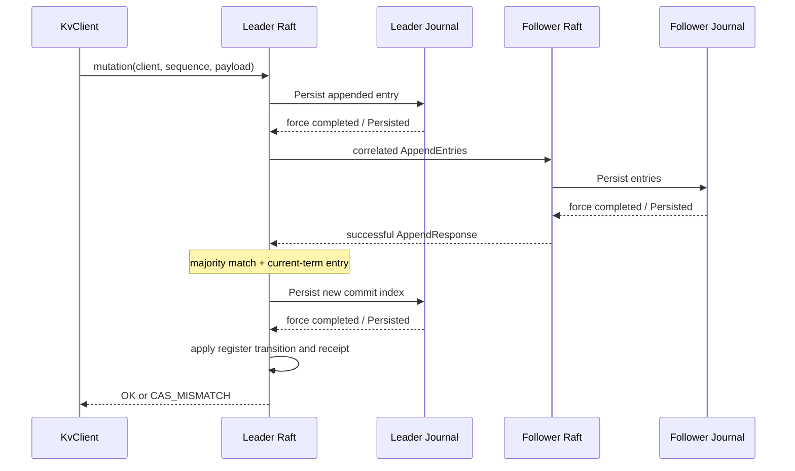

# Architecture and consistency contract

Majority is a fixed-membership, three-node Raft register store. One member owns each protocol state machine; network and disk adapters exchange typed events and effects with it. Success requires a communicating majority and storage that honors the flush/rename contract. A local leader flag alone grants no read authority.

## Source boundaries

| Module | Implementation and responsibility |
| --- | --- |
| `raft-core` | [Raft](../raft-core/src/main/java/io/github/cheshmakzanoon/portfolio/majority/Raft.java) owns elections, log matching, commitment and read barriers. [SnapshotAssembler](../raft-core/src/main/java/io/github/cheshmakzanoon/portfolio/majority/SnapshotAssembler.java) owns one bounded incoming transfer. [Registers](../raft-core/src/main/java/io/github/cheshmakzanoon/portfolio/majority/Registers.java) applies deterministic register/CAS transitions and retry receipts. [Model](../raft-core/src/main/java/io/github/cheshmakzanoon/portfolio/majority/Model.java) defines immutable values and versioned codecs. [Simulator](../raft-core/src/main/java/io/github/cheshmakzanoon/portfolio/majority/Simulator.java) separates virtual network, volatile state and stable writes. |
| `raft-storage` | [Journal](../raft-storage/src/main/java/io/github/cheshmakzanoon/portfolio/majority/Journal.java) owns the directory lock, append-only transactions, generation publication and fail-closed recovery. |
| `raft-transport` | [Binary](../raft-transport/src/main/java/io/github/cheshmakzanoon/portfolio/majority/Binary.java) defines bounded wire framing. [TlsTransport](../raft-transport/src/main/java/io/github/cheshmakzanoon/portfolio/majority/TlsTransport.java) owns TLS channels, role authentication and connection admission. |
| `kv-server` | [NodeMain](../kv-server/src/main/java/io/github/cheshmakzanoon/portfolio/majority/NodeMain.java) adapts protocol effects and local administration. [NodeExecutor](../kv-server/src/main/java/io/github/cheshmakzanoon/portfolio/majority/NodeExecutor.java) owns the protocol/disk execution lifecycle and terminal failure barrier. |
| `kv-client` | [KvClient](../kv-client/src/main/java/io/github/cheshmakzanoon/portfolio/majority/KvClient.java) bounds concurrent requests, validates correlated replies and closes channels. [MutationIdentity](../kv-client/src/main/java/io/github/cheshmakzanoon/portfolio/majority/MutationIdentity.java) serializes a client's uncertain mutation identity. |
| `raft-verification` | [HistoryChecker](../raft-verification/src/main/java/io/github/cheshmakzanoon/portfolio/majority/HistoryChecker.java) independently searches interval-consistent register histories. [ClusterTool](../raft-verification/src/main/java/io/github/cheshmakzanoon/portfolio/majority/ClusterTool.java) records actual request intervals and asserts fault/recovery behavior. [ProcessCluster](../raft-verification/src/main/java/io/github/cheshmakzanoon/portfolio/majority/ProcessCluster.java) owns child JVM identities and cleanup. [LocalTlsIdentity](../raft-verification/src/main/java/io/github/cheshmakzanoon/portfolio/majority/LocalTlsIdentity.java) stages disposable credentials and bounds helper subprocesses. [Workload](../raft-verification/src/main/java/io/github/cheshmakzanoon/portfolio/majority/Workload.java) is the separate closed-loop system driver. |

## Election and persistence ownership

```mermaid
stateDiagram-v2
  [*] --> Follower: recover persisted term/vote/commit
  Follower --> Candidate: election timeout; persist term + self-vote
  Candidate --> Candidate: timeout; start a higher persisted term
  Candidate --> Leader: matching current-term majority votes
  Leader --> Follower: higher-term RPC
  Candidate --> Follower: higher term or valid current-term leader
  Follower --> Follower: persist granted vote before replying
```

The implementation uses randomized election deadlines of 250–499 ms and 50-ms heartbeat scheduling. These are liveness parameters, not a safety lease.

### Liveness hardening: pre-vote, check-quorum and leadership transfer

`Raft.Options.HARDENED` is what `NodeMain` runs; `Options.CLASSIC` (the three-argument constructor's default) is kept so the plain protocol stays testable and comparable. None of the three mechanisms changes what is persisted or when a real vote is granted, so election safety, log matching and the persistence barrier are identical in both modes. Only availability under partitions differs.



- **Pre-vote (thesis §9.6).** On timeout a member asks its peers whether they *would* vote for it at `term + 1`, without raising its term, recording a vote or touching anyone's timer. A voter says yes only if the proposed term is newer, the sender's log is at least as current, it is not itself a leader, and it has not heard from a leader within 250 ms. A partitioned member therefore keeps probing without inflating its term, and a member that returns cannot depose a healthy leader.
- **Check-quorum.** A leader that has not received any reply (even a rejection) from a majority within 500 ms — the longest a follower may wait before campaigning — steps down without changing its term and replies `UNKNOWN_OUTCOME` to its pending clients. An isolated leader no longer labels itself leader indefinitely.
- **Leadership transfer.** An operator asks the leader to hand over to a named member. The leader stops accepting writes (clients get `UNAVAILABLE` with the target as the hint), brings the target's log up to its own, then sends `TimeoutNow`; the target campaigns at once, skipping the probe. The request is answered when the target's first `AppendEntries` arrives (OK) or after one second (`TRANSFER_TIMEOUT`); an unreachable target costs the leader a one-second write pause and nothing else. `TimeoutNow` is only honoured from the member the receiver currently follows, in the receiver's term.

Stepping down from leadership now always draws a fresh election deadline. Previously a deposed leader kept the deadline from before it won, which was normally long past, so it campaigned on its very next tick; the regression is `RaftHardeningTest.aDeposedLeaderWaitsOutAFreshElectionTimeoutBeforeCampaigning`, which fails for both option sets without the change.

Pre-vote and check-quorum are liveness aids, not leases: a stale leader may still briefly believe it leads (reads and writes still need a quorum confirmation), and the 250/500 ms constants assume clocks that advance at similar rates.

`Raft.accept` emits a single `Persist` effect for dirty durable state. Dependent sends, replies and application are held until the matching `Persisted` token. Up to 256 incoming events can wait behind that barrier; excess client work gets resource exhaustion, while dropped peer work behaves as network loss. Acknowledgments from another token cannot release the barrier.

## Mutation acknowledgment



A successful mutation has a stable majority prefix and a locally persisted commit position before application/reply. A failed CAS is a committed result carrying the observed value. Repeated latest sequence/payload returns the stored result; a changed payload conflicts, older sequences are stale, and gaps reject. Receipt state is included in snapshots. Capacity rejections do not advance the client's sequence.

Timeout, connection loss and shutdown unavailability are uncertain outcomes. They do not prove that an admitted command was not committed. The client retains its outstanding identity until `OK` or `CAS_MISMATCH`; it never substitutes a new payload after uncertainty. Client-side retry state is process-local, so callers requiring restartable outstanding operations must preserve the exact command externally.

## Linearizable reads

A new leader first commits its current-term marker. Each read then captures a safe commit position and sends fresh correlated append exchanges to both peers. A matching current-term majority response establishes authority; the reply waits until the captured position is applied. The state machine may have advanced further by reply time, which remains valid within the read's interval.

Responses are matched by term, peer and request identity. A delayed append rejection cannot undo acknowledged progress. Snapshot completion itself does not grant a read acknowledgment: a follower must rejoin append/read-barrier exchanges. Pending reads expire with `UNAVAILABLE`, releasing their bounded state. Administrative status and state digests are observations, not linearizable register reads.

## Snapshot transfer and storage

A leader retains the exact outstanding chunk correlation across heartbeat retransmissions. Receiving a response slower than one heartbeat therefore still advances the transfer. The follower tracks one declared snapshot identity/length in a bounded buffer. A repeated last chunk is checked byte-for-byte and acknowledged without appending it twice; a missing prefix requests offset zero. The complete payload is decoded and checked before becoming a pending durable snapshot. Active register state changes only after its persistence acknowledgment.

Compaction replaces only applied state. It resets outgoing transfer identities so stale responses for an earlier snapshot cannot advance its successor. A follower already at or beyond the requested snapshot can acknowledge completion; retained suffix entries survive only when the last-included index/term matches.

The journal preserves version-1 wire and storage formats. WAL delta sharing compares complete semantic entries, including command bytes. It refuses a changed committed prefix, a changed granted vote within one term, backward commit/term/snapshot movement, and further writes after failed persistence. Recovery validates the selected manifest, snapshot and contiguous WAL before replaying only the persisted commit position. See [storage grammar](../contracts/storage.md).

## Resource and shutdown ownership

`NodeExecutor` checks its terminal state both when admitting work and immediately before executing it. A failed protocol transition or disk write therefore cannot be followed by queued work on partially changed state. The first failure is reported once; the node requires diagnosis and restart.

Shutdown closes admission before transport teardown. Queued protocol actions are abandoned, admitted disk writes finish, and late disk completions cannot restart protocol work. The protocol executor stops before disk admission closes; the journal lock is released only after its writer terminates. Transport cleanup failure does not skip that termination barrier. Cleanup preserves the first failure and attaches later errors as suppressed exceptions; a writer timeout retains the journal lock for a safe cleanup retry. Shutdown deadlines are enforced rather than treated as successful cleanup.

The client uses atomic permits for its 256-request cap and a separate lifecycle lock from mutation sequencing. Close prevents channel publication, completes outstanding calls as unavailable and shuts its owned event loop down. TLS connections have a three-second handshake/first-authenticated-frame deadline, so unauthenticated local sockets cannot retain all 64 inbound slots indefinitely. Authenticated identities remain within the documented trusted local/non-Byzantine boundary.

Protocol reference: [Raft paper, Figure 2 and sections 5/8](https://raft.github.io/raft.pdf). Persistence ordering reference: [etcd integration documentation](https://github.com/etcd-io/raft). Neither implementation is imported.
