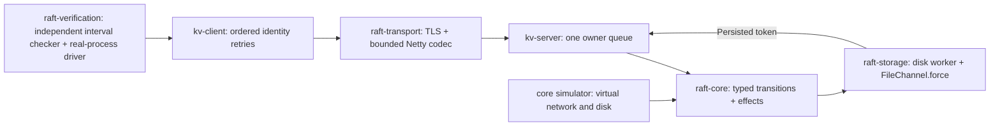

# Architecture

Each member owns term, vote, log, progress, pending reads and the committed state machine on one thread. Netty callbacks enqueue events. A dedicated disk worker persists one transition at a time. Incoming events wait in a bounded FIFO during a persistence barrier; the matching acknowledgment drains the FIFO until the next barrier. Rejected client work receives resource exhaustion. Dropped overloaded peer traffic is retried by Raft and cannot manufacture success.

A candidate persists its increased term and self-vote before sending election requests. A follower persists a granted vote before replying. Leaders persist entries before replication. Followers flush appended entries before a successful AppendResponse. A leader advances commit only when a majority match an entry from its own term. Commit is also persisted here, allowing restart to replay exactly known committed entries; uncommitted retained entries are not applied. This extra flush is a deliberate latency cost.

A leader appends a current-term marker. Reads wait for its commitment, capture a safe committed index, and obtain a fresh correlated majority AppendEntries exchange in the same term. They respond only after the safe index is applied. Read correlation expiry releases bounded pending state without granting a read. Local role flags, last-contact time and observation status cannot establish linearizability. The implementation uses no clock lease.

A register mutation includes client identity, contiguous sequence, operation and SHA-256 payload digest. The replicated state records its latest accepted sequence, digest and result. Same-sequence retries return that result; different payloads conflict; older requests are stale; gaps reject. Failed CAS records the observed committed value without changing the register. Mutation timeouts preserve the supplied client's outstanding command until it is retried. Administrative status contains no linearizable key-value API.

The network uses fixed IDs 0/1/2 and cluster `quorumkv-local-v1`. Port 18300+ID serves authenticated peer and client frames. The administrative role is separately authenticated and every listener binds loopback. See the wire grammar for bounds and trust details.

Protocol reference: [Raft paper, Figure 2 and sections 5/8](https://raft.github.io/raft.pdf). Persistence ordering reference: [etcd Raft integration documentation](https://github.com/etcd-io/raft). Neither implementation is imported.
