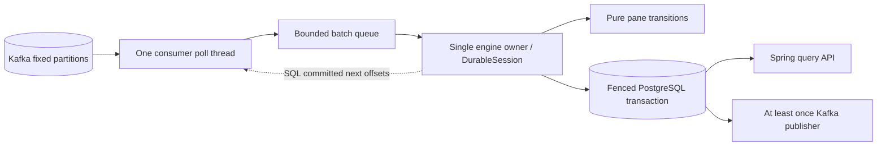

# Event time and the durable boundary

## Window transitions

`engine` owns half-open one-minute tumbling and five-minute sliding windows (one-minute step). Each key/pane stores checked integral count/sum/min/max. Sliding windows merge one to five panes; boundary windows may start before epoch zero. A transition copies committed state, validates all dependent sums before any update, and returns candidate state. A single engine thread owns every mutable collection; candidate state becomes committed only after SQL success. `verification` contains a deliberately non-incremental membership oracle that retains accepted values, enumerates timeline boundaries, and never calls the engine's assignment or merge functions.

## Source progress and finality

Each valid unique measurement or explicit zero-valued source-progress record advances its partition's maximum source time. The candidate is max minus five seconds. The minimum over active partitions advances the job watermark monotonically. Unseen active partitions block progress. Idle classification needs thirty seconds since source activity while polling is eligible, broker lag is known zero, and no local batch is queued. Backpressure/paused inputs, queued deliveries and broker backlog reset the silence proof. All-idle holds the watermark. Restoration clears idle flags and restarts the entire silence interval; a resumed old source cannot move the watermark backward.

A result becomes provisional at window end; a late accepted update increments its revision. At end plus thirty seconds it becomes final and cannot reopen. A measurement can be rejected for the oldest sliding window and still change four other sliding windows. The pane remains until the latest dependent sliding window finishes. Finalized results leave engine memory on the next transition and remain queryable in SQL. Batch quarantine, late rows and publications are deltas; durable histories are held in SQL. Admitted keys and dedup remain until explicit run archival; fixed finite quotas bound their memory/disk growth.

## Durable commit and recovery

`PostgresStore` uses READ COMMITTED plus a run-owner row lock. Acquire inserts the owner if absent, locks it, checks lease against database time, and increments its epoch. Every batch locks the same row, checks epoch and unexpired lease, renews lease, and atomically stores state, source progress, next-offset checkpoints, panes, event hashes, result revisions, quarantine/late rows and outbox entries. This lock serializes takeover with old writes. Kafka offset mirroring happens afterward on the poll owner; it is never used for restoration. Retention gaps and topic UUID changes fail visibly.

State snapshots use a filtered Java serialization stream compressed with GZIP; they are produced only by this implementation and never accepted from HTTP/Kafka. Dedup is restored from normalized rows rather than repeated in every snapshot. Snapshot schema is v1 and currently requires the same Java application version on restore. A rolling upgrade/migration protocol is deliberately outside the supported single-processor boundary.

## Thread ownership and backpressure

The poll owner is a platform thread. It owns assign, seek, poll, pause/resume, positions, end offsets and commitSync. Only `wakeup` crosses ownership (the Kafka-documented shutdown exception). A bounded queue reserves space before fetch, pauses while continuing polling, and records local queue and broker-lag observations. SQL failure poisons the durable session and stops engine progress. The bounded fetched queue is retained until shutdown, and restart rereads from SQL. A possibly lost SQL commit acknowledgement is resolved by restart rather than blindly repeating a revision.

## Wire compatibility

Kafka values use the bounded [v1 envelope](../contracts/event-v1.schema.json). Missing `recordType` means a legacy measurement; a present value must be a recognized string. Wrong types, unknown fields, duplicate members, and invalid routing become explicit quarantine decisions. A malformed envelope advances the source checkpoint without creating aggregate state or consuming an event identity. The next valid retry is evaluated independently.
