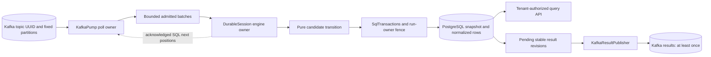

# Event-time processing and durable ownership

PulseStream has one active engine owner per finite run. Kafka carries ordered partition records; PostgreSQL owns the processing decision. A successful input transaction commits retained engine state, logical identities, source next positions, result revisions, diagnostics, and pending output together. Kafka consumer-group offsets are a later operational mirror.



## Source map

| Module | Production responsibilities |
| --- | --- |
| `engine` | [Engine](../engine/src/main/java/io/github/cheshmakzanoon/portfolio/pulsestream/Engine.java): exact aggregates, panes/windows, watermark, source silence, deduplication, quotas, and immutable-input transitions. No Kafka, JDBC, or Spring dependencies. |
| `kafka-adapter` | [EventCodec](../kafka-adapter/src/main/java/io/github/cheshmakzanoon/portfolio/pulsestream/EventCodec.java): strict bounded v1 JSON and Kafka Murmur2 routing. [KafkaPump](../kafka-adapter/src/main/java/io/github/cheshmakzanoon/portfolio/pulsestream/KafkaPump.java): consumer ownership, bounded handoff, retention checks, and offset mirroring. [KafkaResultPublisher](../kafka-adapter/src/main/java/io/github/cheshmakzanoon/portfolio/pulsestream/KafkaResultPublisher.java): broker acknowledgement of stable revision identities. [ThreadTermination](../kafka-adapter/src/main/java/io/github/cheshmakzanoon/portfolio/pulsestream/ThreadTermination.java): bounded owner-thread joining with interruption retained. |
| `postgres-store` | [PostgresStore](../postgres-store/src/main/java/io/github/cheshmakzanoon/portfolio/pulsestream/PostgresStore.java): fenced run persistence, transactional output marks, and parameterized reads. [SqlTransactions](../postgres-store/src/main/java/io/github/cheshmakzanoon/portfolio/pulsestream/SqlTransactions.java): explicit READ COMMITTED commit/rollback/resource outcomes with no automatic replay. [SnapshotCodec](../postgres-store/src/main/java/io/github/cheshmakzanoon/portfolio/pulsestream/SnapshotCodec.java): compatible GZIP/Java state encoding with a concrete class allowlist and byte/graph bounds. [V1 schema](../postgres-store/src/main/resources/db/migration/V1__durable_run.sql) remains immutable. |
| `service` | [DurableSession](../service/src/main/java/io/github/cheshmakzanoon/portfolio/pulsestream/DurableSession.java): candidate/committed state and restart-required failure state. [PulseApplication](../service/src/main/java/io/github/cheshmakzanoon/portfolio/pulsestream/PulseApplication.java): wiring, processing loop, shutdown order, and health metrics. [ApiSecurity](../service/src/main/java/io/github/cheshmakzanoon/portfolio/pulsestream/ApiSecurity.java), [StrictIdentityDecoder](../service/src/main/java/io/github/cheshmakzanoon/portfolio/pulsestream/StrictIdentityDecoder.java), [NoBodyFilter](../service/src/main/java/io/github/cheshmakzanoon/portfolio/pulsestream/NoBodyFilter.java), and [QueryApi](../service/src/main/java/io/github/cheshmakzanoon/portfolio/pulsestream/QueryApi.java): verified tenant reads and request boundaries. |
| `verification` | [BatchOracle](../verification/src/main/java/io/github/cheshmakzanoon/portfolio/pulsestream/BatchOracle.java) and [WorkloadOracle](../verification/src/main/java/io/github/cheshmakzanoon/portfolio/pulsestream/WorkloadOracle.java): independent timeline membership/progress and SQL totals. [ReplayWorker](../verification/src/main/java/io/github/cheshmakzanoon/portfolio/pulsestream/ReplayWorker.java): actual process-failure boundaries and deterministic replay. [Workload](../verification/src/main/java/io/github/cheshmakzanoon/portfolio/pulsestream/Workload.java): seeded durable drain and bounded observations. [EngineBenchmark](../verification/src/main/java/io/github/cheshmakzanoon/portfolio/pulsestream/EngineBenchmark.java): isolated CPU transitions, distinct from durable service work. |

## Window and identity decisions

A one-minute pane contributes to one tumbling window and five five-minute sliding windows with one-minute steps. Windows are half-open: `start <= eventTime < end`. Initial sliding windows may start before epoch zero. Each aggregate uses checked integral count/sum/minimum/maximum; all affected sliding sums are checked before any aggregate is changed.

A transition copies the committed state and returns a candidate. A result is provisional once its window ends, receives a higher revision on a permitted late update, and becomes final at `end + 30 seconds`. Final windows cannot reopen. One event may be late for its tumbling window while still contributing to four sliding windows. Panes survive until the latest dependent window is final. Final results leave the next engine state and remain queryable in SQL.

Logical identity is `(run, tenant, eventId)` with a hash of the complete canonical payload. Malformed/schema/routing records advance the physical source position and create quarantine without reserving identity. A structurally valid new identity is reserved before key/pane/arithmetic admission; a quota or overflow decision therefore remains stable on retry. Neither deduplication nor admitted-key history expires during a run. State copying and identity history have a cost proportional to retained state; this implementation relies on finite quotas and explicit archival rather than claiming unbounded stream processing.

## Watermarks and source silence

Valid unique measurements and zero-valued progress records advance a partition's maximum event time. Its candidate watermark is `maximum − 5 seconds`; the minimum among active partitions advances the run watermark monotonically. An unseen active partition blocks progress. All-idle holds the existing watermark.

A partition becomes idle only after 30 seconds of eligible silence: polling is not paused, broker lag is known zero, and no locally admitted batch is awaiting SQL acknowledgement. Queued and in-flight batches share one outstanding count, so removing a batch from the queue cannot briefly invent an empty local pipeline. Backpressure/backlog resets the silence interval. Restoration clears idle flags and starts a fresh interval; a resumed old source cannot move the watermark backward.

## Processing transaction and acknowledgement

```mermaid
sequenceDiagram
  participant Poll as Poll owner
  participant Owner as Engine owner
  participant DB as PostgreSQL
  Poll->>Owner: Immutable batch + source observations
  Owner->>Owner: transition(committed) -> candidate
  Owner->>DB: BEGIN READ COMMITTED; lock run_owner
  DB-->>Owner: Matching epoch + live database-time lease
  Owner->>DB: State, identities, positions, results, diagnostics, outbox
  Owner->>DB: Renew locked lease; COMMIT
  DB-->>Owner: Acknowledged commit
  Owner->>Owner: candidate becomes committed
  Owner->>Poll: Durable next positions; release admitted-batch count
  Poll->>Poll: commitSync mirror on consumer owner
```

Acquisition locks `run_owner`, rejects an unexpired owner, and increments the epoch. Every state or output transaction locks the same row, checks epoch and database-time lease, and renews it. Takeover and old writes serialize on that lock. A transaction may outlast its nominal lease while holding the row; a successor still cannot acquire it. Renewal immediately before commit prevents successful slow work from immediately exposing an expired lease.

The retained snapshot contains next positions; normalized checkpoint/progress rows are written in the same transaction. Restore reads the SQL snapshot and normalized deduplication rows, then seeks Kafka explicitly. It never restores from a broker group commit. A topic UUID/partition-count change or an offset outside the retained range is fatal; resetting to earliest/latest would hide source loss.

```mermaid
stateDiagram-v2
  [*] --> Ready: acquire and restore
  Ready --> Candidate: pure transition
  Candidate --> Ready: SQL commit acknowledged; adopt candidate
  Candidate --> RestartRequired: SQL, application, or fatal commit-path failure
  RestartRequired --> [*]: stop and release or expire lease
  Ready --> [*]: owner stopped before resource release
```



There is no internal transaction replay. A failed or unknown commit poisons the session and requires SQL-authoritative restart. Rollback/close diagnostics remain secondary to the original failure. If commit returned normally and only connection cleanup fails, the known committed result is retained and a warning recorded. This is distinct from a lost commit acknowledgement.

## Output delivery and shutdown

An output key is `run:windowId:revision`. Delivery holds the owner fence and pending outbox row locks, waits for Kafka `acks=all`, then marks the revision delivered in the same SQL transaction. Publication and the mark span two systems: failure after publication can repeat a key. A partial batch publication failure rolls back all of that transaction's delivery marks; retry uses the same identities. Downstream consumers must handle duplicates. This is at-least-once delivery, including when Kafka's producer idempotence is enabled.

Shutdown first stops/interrupts the engine owner and waits for it to terminate, then stops the poll owner, closes the publisher, and releases the database owner. Interrupting the cleanup caller does not skip these waits; its interrupt is restored after resource cleanup. An engine termination timeout is explicit and does not authorize closing resources or releasing ownership beneath a live owner. Queued uncommitted batches may be discarded because restart seeks the SQL next position. A final broker mirror can lag shutdown without losing the SQL decision.

Engine join, poll join, consumer close, publisher close, SQL, and lease budgets are separate; their sum is not a single service deadline. Slow output delivery holds the run lock and delays source processing/takeover. The supported model is one active finite-run processor, with no distributed rescaling protocol.

## Snapshot compatibility

Stored snapshot and result bytes retain the V1 GZIP/Java encoding. The decoder admits only the concrete engine graph and required collection/scalar classes. It enforces depth 40, ten million references/array elements, and 512 MiB of decompressed bytes; byte counting also covers skipped data where object filters alone are insufficient. A legacy-format fixture restores the retained graph and result payload. HTTP/Kafka never accept Java snapshots.

These bounds contain malformed stored payloads; they do not make arbitrary Java serialization a public ingestion format. Restoration still requires a compatible application version, original run limits, retained source ranges, and the recorded topic identity. Rolling upgrades and state migration remain separate engineering work.

## Development process ownership

The shell lifecycle has its own resource boundary. [up.sh](../scripts/up.sh) records preexisting all/running container IDs before acquisition; its failure trap restores stopped/running ownership and removes only newly created IDs. [runtime-process.py](../scripts/runtime-process.py) binds a launched process to boot/start identity and the exact artifact, and verifies that authority again after opening a PID file descriptor. Shutdown waits for that recorded process; source/JAR replacement cannot be mistaken for a current running build. Container volumes outlive this resource boundary.

[run-bounded.py](../scripts/run-bounded.py) owns a separate POSIX process group for each short command. It observes leader exit without reaping, cleans the group, then reaps the leader; cleanup remains bounded when descendants resist TERM. [Process regressions](../scripts/test-lifecycle.py) run actual children with controlled Compose/HTTP adapters. These tests verify local ownership and failure handling independently of real Kafka/PostgreSQL recovery tests.

Executable identity is mandatory when publishing a new process record. If a managed procfs later denies only executable dereference with `EACCES`/`EPERM`, boot/start identity and the hash of every exact command argument remain mandatory; a readable executable must still match. Other read failures refuse ownership. Two kernel-stat reads bracket the argument/executable observation, and a changed kernel start identity refuses control. Argument hashes avoid retaining command configuration or secrets in the record.
