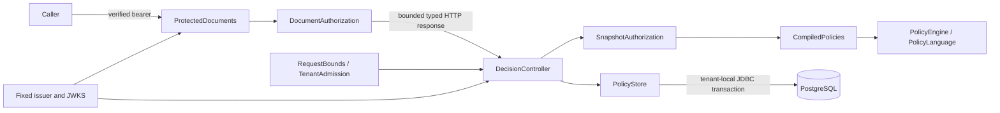
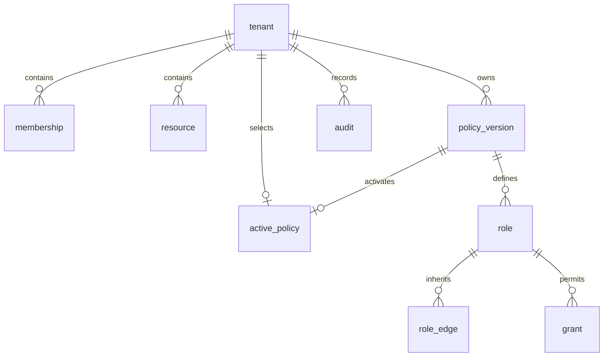
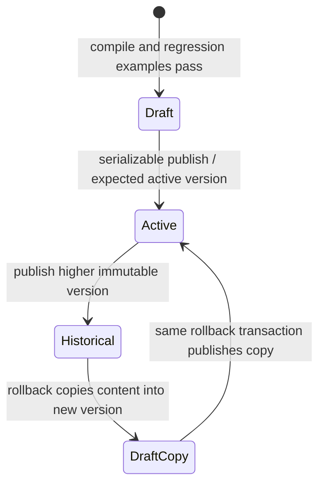

# Architecture

Gatehouse authorizes document reads from one PostgreSQL snapshot and commits the decision's audit before responding. Identity verification, policy semantics, snapshot assembly and outbound authorization each have a separate owner.

## Components and ownership



| Production source | Responsibility and boundary |
| --- | --- |
| [PolicyLanguage](../policy-core/src/main/java/io/github/cheshmakzanoon/portfolio/gatehouse/PolicyLanguage.java) | Dependency-free typed parser, immutable AST, three-valued logic and independent evaluation budget |
| [PolicyEngine](../policy-core/src/main/java/io/github/cheshmakzanoon/portfolio/gatehouse/PolicyEngine.java) | Role DAG closure, compiler-owned immutable plans, scoped grant/rule indexes, digest and deterministic combining |
| [PolicyAnalyzer](../policy-core/src/main/java/io/github/cheshmakzanoon/portfolio/gatehouse/PolicyAnalyzer.java) | Dependency-free static analysis in Kleene logic: bounded search for impossible, certain and shadowed conditions, with undecided searches reported rather than guessed |
| [PolicyStore](../policy-store/src/main/java/io/github/cheshmakzanoon/portfolio/gatehouse/PolicyStore.java) | Sole JDBC transaction owner; snapshot reads, administrative writes, mandatory audit and conflict classification |
| [RuntimeDatabase](../policy-store/src/main/java/io/github/cheshmakzanoon/portfolio/gatehouse/RuntimeDatabase.java) | Startup verification of runtime role, all nine protected tables, RLS and ownership |
| [StoreAdmin](../policy-store/src/main/java/io/github/cheshmakzanoon/portfolio/gatehouse/StoreAdmin.java) | Separate Flyway process; migration credentials never enter the service configuration |
| [DecisionApplication](../decision-service/src/main/java/io/github/cheshmakzanoon/portfolio/gatehouse/DecisionApplication.java) | Spring lifecycle, fixed OIDC trust, Hikari ownership and runtime database guard |
| [DecisionController](../decision-service/src/main/java/io/github/cheshmakzanoon/portfolio/gatehouse/DecisionController.java) | HTTP contracts, validated principal/context, draft examples, publication preconditions and error responses |
| [SnapshotAuthorization](../decision-service/src/main/java/io/github/cheshmakzanoon/portfolio/gatehouse/SnapshotAuthorization.java) | Binds server-owned membership/resource attributes to an immutable validated caller context |
| [CompiledPolicies](../decision-service/src/main/java/io/github/cheshmakzanoon/portfolio/gatehouse/CompiledPolicies.java) | 500-plan Caffeine maximum-size policy, keyed by tenant/version/digest; rejects corrupt stored policy |
| [RequestBounds](../decision-service/src/main/java/io/github/cheshmakzanoon/portfolio/gatehouse/RequestBounds.java) / [TenantAdmission](../decision-service/src/main/java/io/github/cheshmakzanoon/portfolio/gatehouse/TenantAdmission.java) | Bounded body buffering and explicitly owned concurrency leases; quota counters survive tenant churn |
| [ProtectedDocuments](../demo-resource-server/src/main/java/io/github/cheshmakzanoon/portfolio/gatehouse/ProtectedDocuments.java) / [DocumentAuthorization](../demo-resource-server/src/main/java/io/github/cheshmakzanoon/portfolio/gatehouse/DocumentAuthorization.java) | Independently verifies identity and obtains one fresh, complete decision per document read |
| [Workload](../verification/src/main/java/io/github/cheshmakzanoon/portfolio/gatehouse/Workload.java) | Disposable data preparation and authenticated HTTP workload; separate from the service runtime |
| [PolicyBenchmark](../verification/src/main/java/io/github/cheshmakzanoon/portfolio/gatehouse/PolicyBenchmark.java) / [FlightSummary](../verification/src/main/java/io/github/cheshmakzanoon/portfolio/gatehouse/FlightSummary.java) | Component measurements and bounded JFR aggregation; measurement limits are in [performance](PERFORMANCE.md) |

## Decision and failure sequence

```mermaid
sequenceDiagram
    participant H as DecisionController
    participant S as PolicyStore
    participant P as PostgreSQL
    participant A as SnapshotAuthorization
    participant C as CompiledPolicies
    H->>H: Validate action/resource and Context
    H->>S: decide(tenant, verified principal, evaluator)
    S->>P: BEGIN REPEATABLE READ; SET LOCAL tenant/timeouts
    S->>P: Read epoch and current membership
    alt Missing or inactive membership
        S->>S: DENY NO_MEMBERSHIP; never call evaluator
    else Active membership
        S->>P: Read active immutable revision and resource
        S->>A: Evaluate the assembled snapshot
        A->>C: Resolve (tenant, version, digest)
        C-->>A: Compiler-owned immutable plan
        A-->>S: Conservative decision and sorted rule IDs
    end
    S->>P: INSERT redacted audit
    S->>P: COMMIT
    S-->>H: Decision plus observed versions and audit UUID
    Note over S,P: Setup, evaluation, audit or commit failure rolls back; no ALLOW response
```

The transaction-local tenant setting clears on commit/rollback before Hikari reuses the connection. `PolicyStore` rejects nested transactions before acquiring another connection. It preserves the primary failure if rollback also fails; serialization/deadlock SQL states become a conflict, while other JDBC failures become unavailable. A missing membership gets zero public epoch/policy/resource metadata; a retained revoked membership may observe the tenant epoch. Both receive a persisted denial.

The plan cache uses Caffeine's maximum-size eviction policy of 500 plans and stores syntax and indexes only. Membership, resource attributes, epochs and decisions are read or computed anew. Concurrent loads for one cache key share one compilation; failed loads are not retained. Stored parse errors, invalid metadata, invalid attributes and digest mismatches are dependency failures rather than caller validation errors.

## Policy semantics and work limits

`editor -> reader` means an editor inherits the reader role and its grants. Compilation rejects missing parents, cycles, duplicate grants/rule IDs, invalid identifiers and unknown role predicates. Plans privately own their definition, closure, scope indexes and digest; even the compatibility constructor rederives and verifies supplied state. Grant lookup uses the exact `(action, resourceType)` scope, followed by rules indexed to that same scope.

A matching RBAC grant and a true ALLOW condition are both required. A true DENY wins, then any applicable UNKNOWN yields INDETERMINATE, then absence of a grant or true ALLOW denies. Explanations sort rule IDs lexically. Missing attributes propagate UNKNOWN through comparison and negation; `exists(field)` tests presence explicitly. The independent interpreter checks both evaluation and indexed decisions against generated policies.

The language accepts only approved boolean, string, int64 and sensitivity-enum fields. Expressions allow boolean composition, comparisons, literal membership, `exists` and `hasRole`. There is no script execution or external I/O. Limits are 16,384 UTF-8 bytes, 512 AST nodes, parser recursion depth 32, 64 set elements and 256 UTF-16 units per string. Well-formed surrogate pairs are required. Evaluation has a separate 1,024-node visit budget. A policy permits at most 100 roles, 200 rules and 2,000 grants; the serialized revision is at most 262,144 bytes. These limits bound work; they are not latency guarantees.

## Static policy analysis

[PolicyAnalyzer](../policy-core/src/main/java/io/github/cheshmakzanoon/portfolio/gatehouse/PolicyAnalyzer.java) answers questions about a compiled policy without evaluating a request. A condition is converted twice into negation-free formulas over atoms: the formula under which it is TRUE and the formula under which it is FALSE. Kleene negation keeps UNKNOWN unknown, so FALSE is not the Boolean complement of TRUE, and an ALLOW decision needs every DENY rule definitely FALSE, not merely not TRUE. Questions are posed accordingly: "never TRUE" is unsatisfiability of the TRUE formula, "always TRUE" is unsatisfiability of its complement (which includes absent attributes), and "ALLOW shadowed" is unsatisfiability of the allow's TRUE formula conjoined with the FALSE formula of the DENY rules.

Satisfiability is a depth-first search over disjunctions with pruning. Atoms are comparisons and set tests against constants, attribute presence, role membership and, as free propositions, comparisons between two different attributes. The truth of every constant-based atom is constant between consecutive mentioned constants, so representative values (each constant, its neighbours, the type's extremes, and the absent state) decide a conjunction exactly. Role requirements are decided with the policy's own inheritance closure. A per-question and per-analysis step budget makes pathological conditions inconclusive instead of slow.

Soundness is the property that matters: every impossibility or certainty claim must hold for every input. It is checked against an independent decision procedure that shares nothing with the solver, an exhaustive grid of attribute values and role subsets evaluated through the production interpreter. Across 420 generated policies every claim is confirmed, and findings are also exact (not merely sound) whenever no two-attribute relation is involved. An earlier design that approximated a two-attribute comparison as "both present" would have reported `(a == b) or not exists(a) or not exists(b)` as always true; modelling the comparison as a free proposition fixed that, and both a named regression and the generated oracle fail if the approximation is restored. `PolicyEngine.explain` shares its evaluation loop with `decide`, so an explanation cannot disagree with its decision, and `PolicyLanguage.format` prints canonical text that re-parses to an equal tree.

## Schema and immutable publication

The [migration](../policy-store/src/main/resources/db/migration/V1__tenant_authorization.sql) defines nine protected tables, each with tenant RLS and FORCE RLS. Revision-scoped composite foreign keys prevent a role edge or grant from referring to another tenant or revision.





Draft creation, publication, rollback and membership changes run serializably, lock the tenant row, and recheck current administrative membership. Publish requires one canonical strong `If-Match` tag and a higher version. Rollback validates the old content, copies it into a newly numbered revision, then updates the active pointer and audit atomically. Database triggers reject revision mutation and non-increasing active pointers; membership/resource/pointer changes advance the tenant epoch. Resource updates also advance the resource version.

Writers lock the tenant with `FOR NO KEY UPDATE`. This serializes epoch writers while allowing the decision audit's foreign-key `FOR KEY SHARE` check to complete from an older repeatable-read snapshot. The previous `FOR UPDATE` lock caused SQLSTATE 40001 in this exact schedule; the latched integration regression preserves it.

A snapshot established after revocation commits sees revoked membership. An older snapshot may finish at its earlier epoch. A remote decision cannot make a later resource write atomic with revocation; a write service requiring that guarantee must coordinate epoch validation with its own resource transaction.

## Capacity and lifecycle

`TenantAdmission` owns every accepted request through an idempotent `AutoCloseable` lease. At most 64 leases exist. Up to 1,000 named quota buckets remain stable during their current fixed window and while leased; stale inactive buckets are reclaimed under pressure. Additional tenant names share one overflow budget, preventing eviction from resetting a live quota. The maximum is 5,000 accepted requests per bucket per second; fixed windows allow a boundary burst.

The protected client requires HTTP 200, JSON, a body at most 65,536 bytes and a strictly typed complete decision. An ALLOW must have the expected reason, positive versions/epoch, a UUID and sorted unique rule IDs. Invalid or unavailable responses become 503; an explicit valid DENY becomes 403. It does not cache decisions.

[Startup](../scripts/up.sh) records preexisting Compose container IDs and newly started service PIDs. Failed startup stops its new service processes and removes its new containers, preserving existing containers and data volumes. [Bounded commands](../scripts/run-bounded.py) own their process group and clean descendants after normal exit, deadline or signal; repeated signals cannot interrupt cleanup. See [operations](OPERATIONS.md) for recovery and [security](SECURITY.md) for the limits of these boundaries.
