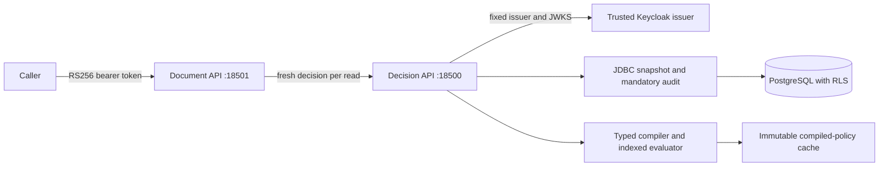

# Architecture

TenantShield separates authentication, authorization semantics, and persistence. Spring Security verifies identity; a dependency-free policy core evaluates explicit rules; PostgreSQL establishes the tenant and snapshot boundary.

## Responsibilities

| Module | Responsibility |
| --- | --- |
| `policy-core` | Bounded recursive-descent parser, static types, three-valued logic, role closure, candidate index and deterministic explanations |
| `policy-store` | Transaction boundaries, RLS context, immutable revisions, expected-version publication, snapshots and audit |
| `decision-service` | Verified principal binding, request validation, quotas, compiled-policy caching and HTTP responses |
| `demo-resource-server` | A protected document endpoint that requires a fresh decision and refuses dependency failures |
| `verification` | PostgreSQL/Keycloak integration tests, authenticated workload and separate component benchmarks |

## Decision transaction

1. Validate the request, its typed context, and the signature-verified identity. Context cannot supply subject or resource attributes.
2. Begin a repeatable-read transaction and set transaction-local tenant context. Read epoch, current membership, active policy, and resource attributes from that snapshot. Nonmembers cannot resolve resource or policy metadata.
3. Retrieve the compiled policy by `(tenant, immutable version, content digest)`. The cache holds at most 500 immutable ASTs and never stores authorization results. A miss recompiles stored content and verifies its digest.
4. Expand assigned roles, select rules by action/resource type, and evaluate conditions. A matching grant and true ALLOW are required. A true DENY wins; otherwise any applicable UNKNOWN produces INDETERMINATE. Explanations sort rule IDs lexically.
5. Insert the redacted audit and commit before returning the decision. An audit or database failure cannot return ALLOW.

`editor -> reader` means an editor inherits the reader role and its grants; the reverse does not hold. Missing attributes propagate UNKNOWN through comparisons and negation. `exists(field)` tests presence explicitly. No applicable rule means default deny.

## Publication and revocation

Administrative mutations use serializable transactions and lock the tenant row before checking current administrative membership. Drafts are compiled and checked against supplied regression examples before storage. Publication requires one strong `If-Match` tag for the active version and atomically changes the pointer to a higher immutable version. Stale versions return 409; malformed tags return 400 before database access. Rollback copies old content into a newly numbered revision and publishes it in one transaction.

Membership, resource, and active-pointer triggers advance a monotonic tenant epoch. Tenant writers use `FOR NO KEY UPDATE`: they exclude competing epoch writers while remaining compatible with audit foreign-key `FOR KEY SHARE` checks. An earlier `FOR UPDATE` implementation caused SQLSTATE 40001 when an old-snapshot decision attempted its mandatory audit after an epoch update; the integration regression preserves that schedule.

A decision whose snapshot begins after revocation commits sees the revoked membership. An existing snapshot may finish under its earlier epoch. The remote response cannot make a later resource write atomic with policy changes; stronger enforcement requires coordinating an epoch check with the resource transaction.

## Tenant boundary

Composite tenant keys and foreign keys accompany RLS on protected tables. Tenant context is transaction-local, so commit or rollback clears it before a pooled connection is reused. Startup rejects a runtime role that owns the membership table, is a superuser, or bypasses RLS. Migrations use a separate privileged process.

RLS limits accidental missing predicates and pool leakage. It does not protect against an attacker holding raw runtime SQL credentials who can set the tenant context directly. SQL access remains inside the trusted service boundary. See [security](SECURITY.md) for request limits, identity validation, audit privacy, and deployment exclusions.
