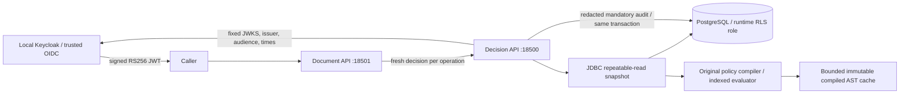

# Architecture

The policy-core module has no Spring/JDBC dependency. It owns recursive descent, static types, strong Kleene truth tables, role closure, action/type indexing, explicit deny precedence and stable rule IDs. The store owns consistency, immutable revisions, RLS context, version-conflict checks and audit. The decision service owns trusted JWT validation and binding `(issuer,subject)` to current database membership, body/context bounds, quotas, caching and HTTP. The resource service trusts a fresh decision only for that operation and fails closed on dependency errors. Verification owns real PostgreSQL/Keycloak adversarial and concurrency tests, JMH and the authenticated load driver.

Each decision uses one REPEATABLE READ transaction. `set_config(...,true)` establishes transaction-local tenant scope, then epoch, membership, active immutable version and resource come from one snapshot. Audit must commit before an allow response. No allow-result cache exists. Compiled cache keys include tenant, version and content digest, maximum 500 entries. Cache eviction recompiles from database immutable content; it never substitutes another version or tenant. Publication cannot mutate an existing AST.

A policy revision contains its own role DAG. `editor -> reader` means the child editor inherits reader's roles and RBAC grants. Assigning reader does not confer editor. A rule applies solely by action and resource type before its boolean condition is evaluated. Applicable explicit TRUE deny wins; otherwise any applicable UNKNOWN/error yields INDETERMINATE; otherwise both an effective role grant and TRUE allow are required. No relevant rule means default deny. Condition iteration and matched IDs are lexically sorted by stable rule ID.

Administrative mutations run SERIALIZABLE, lock the tenant row first, then check current administrative membership in that transaction. Conflicts are explicit 409 responses; there is no uncontrolled retry. Drafts are compiled and their supplied regression examples checked before storage. The active pointer updates atomically under an expected prior active version. Version numbers are assigned monotonically under the tenant lock; publication may only increase the active version. Rollback copies the selected old contents into a new immutable version and publishes it within one expected-version transaction, incrementing the epoch. PostgreSQL triggers advance the tenant epoch for membership/resource/active-pointer changes, including direct maintenance writes.

RLS uses composite tenant keys/FKs on all protected tables and transaction-local context. The application validates that the runtime role is neither owner, superuser nor BYPASSRLS. Schema setup uses a separate migration role; migration credentials never enter the application processes. This prevents accidental missing tenant predicates and pooled session leakage. It does not protect against an attacker holding runtime SQL credentials who can set tenant context directly; SQL access is inside the trusted server boundary.

Snapshot-boundary guarantee: a snapshot established after revocation commits sees the new membership and higher epoch. An already established snapshot may finish under its prior epoch. The remote decision cannot make a later resource write atomic with revocation; an application needing that stronger guarantee must coordinate epoch checking in its resource transaction.

Administrative epoch locking uses `FOR NO KEY UPDATE`: tenant identity remains stable, so writers need to exclude other epoch writers while allowing audit foreign-key `FOR KEY SHARE` checks. `FOR UPDATE` was experimentally shown to cause SQLSTATE 40001 for an older repeatable-read decision inserting its audit after an epoch writer committed. The weaker key-conflict mode does not weaken mutual exclusion between administrative writers or change the snapshot isolation contract. See CASE_STUDY and the exact observed integration checkpoint.
