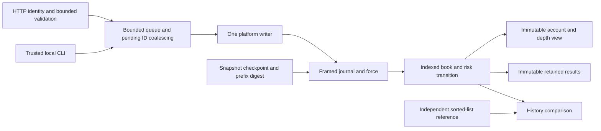

# State and failure boundaries

`matching-core` owns the original algorithm. Ordered TreeMaps find best prices; each level has a doubly linked FIFO and aggregate quantity; a hash index maps account/order to its node. FIFO pointer unlink is O(1) after lookup; removing an emptied price level from its TreeMap is O(log P), where P is the number of price levels. Creating a new price level is also O(log P); matching traverses only consumed makers. Remaining orders are immutable only at the view boundary.

`journal` owns versioned NIO records and the exclusive file lock. A 24-byte independently checksummed header contains magic, schema, sequence and bounded length; payload JSON and its CRC32C follow. Full-write loops precede `force(true)`. Only incomplete final records can be truncated. Every complete record and every sequence must validate, even if a snapshot exists.

`gateway` confines book mutation to one writer. Synchronized admission determines queue order, bounds in-flight commands and coalesces a pending stable ID before any sequence exists. An identical retry shares its future; a different canonical record hash conflicts. The writer forces, applies, publishes immutable depth/account state, then completes responses. BlockingQueue publication, volatile view assignment and CompletableFuture completion provide happens-before edges. Readers never traverse the mutable index. Result and execution publication occurs only after force and application. A reader can require a minimum applied sequence; account/depth snapshots share that sequence.

A finite run caps admission at at most 1,100,000 unique command IDs and 100,000 open orders. All outcomes and terminal identities are retained, not silently evicted. Each fill terminates a maker or incoming order revision, bounding total fills by admitted revisions. Overload and run exhaustion reject before sequence allocation. A failed force or writer fault closes admission; restart replays durable commands, including unknown client outcomes.

`simulator` uses a structurally independent flat sorted-list matcher, recomputes reservations from orders and uses BigInteger supply checks. Generated histories compare complete observable state and outcomes after every transition. `benchmarks` separates JMH apply microbenchmarks from seeded core and forced-service drivers.

Snapshots contain immutable state, used terminal IDs, schema, last sequence and verified journal-prefix digest. A checksum covers serialized checkpoint bytes. Publication forces a temporary file, atomically renames and forces the directory. Recovery validates the entire retained journal, restores a valid checkpoint and applies its suffix. Missing, corrupt or mismatched snapshots fall back to replay. Baseline does not prune logs; snapshot validation still reads the full log.
