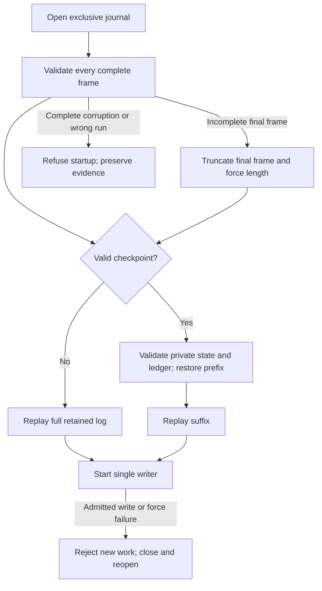

# Running and recovering

Use JDK 25 and the repository wrapper. No Docker, database or external account is needed. From the repository root:

```bash
./mvnw -f projects/06-matchcore/pom.xml -B -ntp verify
./mvnw -f projects/06-matchcore/pom.xml -B -ntp -Pintegration,mutation verify
./scripts/portfolio.sh demo matchcore
```

In the managed workspace, source `scripts/cloud-env.sh` first. Add `-Dmaven.repo.local="$PWD/.work/A06/m2"` for a dedicated cache. The `integration` profile adds real-process SIGKILL recovery and slow-upload deadline checks. The `mutation` profile checks matching/model/checkpoint, journal and gateway classes; it retains the existing 70% threshold. Supported scripts verify source-bound runtime artifacts before reuse.

The normal product workflow is CLI-first and has no background process. `scripts/up.sh` initializes the local runtime directory and prints CLI readiness, `scripts/demo.sh` verifies artifacts and asserts the deterministic scenario, and `scripts/down.sh` preserves journals. `scripts/reset-demo.sh` removes only generated `.runtime/demo.*` directories. The optional `scripts/serve.sh` runs HTTP in the foreground; Ctrl-C closes it. A service manager can own that foreground process.

## Stable identities and unknown outcomes

Local demonstration request:

```bash
curl --fail-with-body http://127.0.0.1:18600/commands \
  -H 'X-Demo-Account: alice' -H 'Content-Type: application/json' \
  --data '{"clientCommandId":"init-1","accountId":"alice","type":"INIT","priceTicks":0,"quantityLots":0,"postOnly":false,"initialCash":20000,"initialLots":0}'
curl --fail-with-body -H 'X-Demo-Account: alice' \
  http://127.0.0.1:18600/commands/init-1
```

The demo header is trusted local input, not authentication. Protected mode requires the configured issuer and bearer scopes; INIT additionally requires admin, and the subject must still equal `alice`.

A successful response contains the durable sequence and business result. A `202 OUTCOME_UNKNOWN_QUERY_STABLE_ID`, client timeout, disconnect or `503` after admission cannot prove cancellation. Query the same account/command ID, or resend the exact same payload under that identity. A changed payload under an existing identity returns `409 CONFLICT`. Never invent a new ID solely because the first response was lost. Pre-admission queue overload returns `429`; keep the same identity while backing off. The finite run cap also uses that HTTP status/error body. Once exhausted, retain the old journal and use a dedicated new run for new commands; existing command IDs remain queryable and retryable.

`GET /book?minimumSequence=N` waits up to two seconds for publication; timeout returns 202. Account and execution reads carry the applied sequence. `GET /health` becomes 503 after writer/storage failure. Stop the service, preserve storage and investigate; no in-memory success path replaces failed durability.

## Journal lifecycle and recovery



The journal has OPEN, FAILED and CLOSED states. Command/sequence/size validation occurs before storage admission and leaves OPEN reusable. Any failure once append storage work begins marks FAILED; subsequent append and snapshot calls refuse until a new instance recovers the retained bytes. A complete but unforced frame may survive process death, so recovery accepts either valid prefix at that boundary. After successful force, the command must survive within the retained-storage model.

A second writer cannot acquire the lock. Recovery validates complete headers, length/version, CRCs, schema, run identity and contiguous sequence. Only an incomplete final frame is truncated. A complete corrupt frame fails startup; do not delete records to make it disappear. Cleanup attempts both lock release and channel close, retaining the recovery/write failure as primary and cleanup failures as suppressed.

## Checkpoints and backup

Snapshots require a healthy, idle gateway. They are optional hints: the full journal remains authoritative. Publication writes a temporary file, forces it, atomically renames it, then forces its directory. A failed snapshot does not poison the command journal. Missing, corrupt, oversized, structurally invalid or wrong-prefix snapshots trigger full replay. Prefix ledger checks bind balances and result identities to commands without rematching the prefix. Gateway rebuilds exact command authority from the retained records, so a legacy v1 hash collision cannot make a changed retry appear identical. Standalone matching-library callers restoring only state must provide the original ordered prefix through the authority overload before historical retry lookup; state-only lookup fails closed. Recovery still reads all journal frames; it is not constant-time startup.

Before recovery experiments, stop the writer and copy the journal plus optional `.snapshot` into a cold backup. Restore into a dedicated directory using the original run ID; never open two writers on the same path. Retain original bytes when diagnosing corruption. Tests use disposable directories and terminate only their owned child processes.

Format remains v1, with no log pruning, online migration or replication. Identifiers and initial balances are explicit command inputs. Snapshot envelopes above 16 MiB reject publication while full-log recovery remains available. Runs above 1,100,000 entries refuse recovery. Local disk loss requires an external backup; CRCs/hashes do not authenticate an attacker who controls the data directory.

## HTTP time budgets

Standalone startup sets JDK `sun.net.httpserver.maxReqTime` and `maxRspTime` defaults to five seconds before server initialization. Explicit JVM `-D` settings override them. The settings are JVM-wide and use the JDK server's periodic timeout checks; embedded applications must set policy before their first HTTP server. The separate-process slow-upload test verifies the supported CLI defaults free all four handler permits. Connection/rate limits and TLS remain the responsibility of a surrounding deployment.
