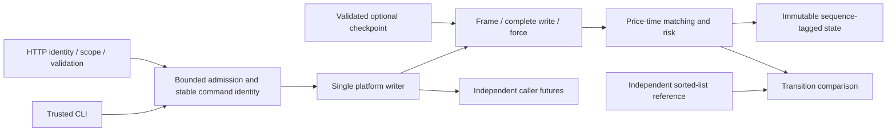
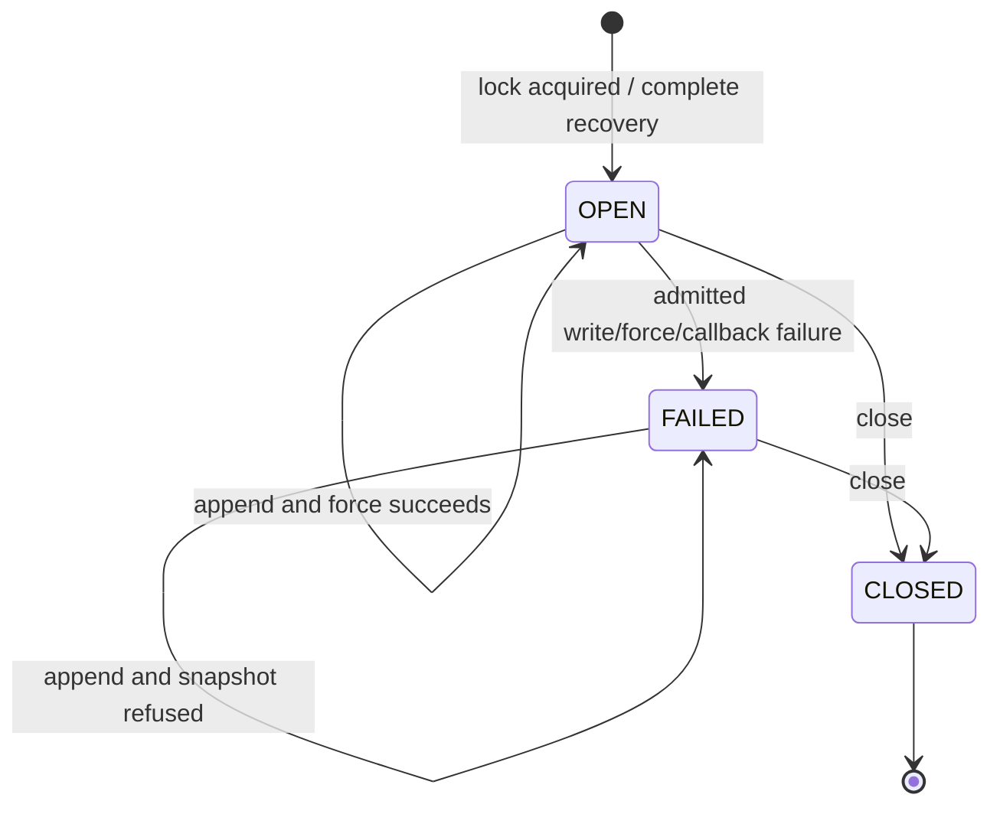

# State and failure boundaries

The Pit separates concurrent admission, durable command ownership, matching and immutable reads. A single writer owns every business transition. The journal is authoritative; a client future and an optional checkpoint cannot create an acknowledged outcome independently.



## Production source map

| Source | Responsibility |
| --- | --- |
| [Model](../matching-core/src/main/java/io/github/cheshmakzanoon/portfolio/thepit/Model.java) | Immutable commands/results/views, checked decimal conversion, stable identity and digest |
| [Book](../matching-core/src/main/java/io/github/cheshmakzanoon/portfolio/thepit/Book.java) | Thread-confined matching, reservations, result retention and atomic restore |
| [BookCheckpoint](../matching-core/src/main/java/io/github/cheshmakzanoon/portfolio/thepit/BookCheckpoint.java) | Account, reservation, order/index, priority, terminal identity and complete result/execution invariants |
| [CommandJson](../journal/src/main/java/io/github/cheshmakzanoon/portfolio/thepit/CommandJson.java) | Shared strict HTTP/journal JSON types |
| [MarketData](../matching-core/src/main/java/io/github/cheshmakzanoon/portfolio/thepit/MarketData.java) | Pure derivation of top of book, depth, exact run statistics and a bounded anonymous tape; every accumulator is total so it can never fail the writer that feeds it |
| [JournalReader](../journal/src/main/java/io/github/cheshmakzanoon/portfolio/thepit/JournalReader.java) | The single parser of v1 frames, shared by writer recovery and by offline inspection that never locks, truncates, forces or writes |
| [Journal](../journal/src/main/java/io/github/cheshmakzanoon/portfolio/thepit/Journal.java) | Exclusive file lock, serialized frame ownership, force, recovery and checkpoint ancestry/ledger checks |
| [Gateway](../gateway/src/main/java/io/github/cheshmakzanoon/portfolio/thepit/Gateway.java) | Admission, single writer, private pending promises, publication and shutdown |
| [HttpApi](../gateway/src/main/java/io/github/cheshmakzanoon/portfolio/thepit/HttpApi.java) | Account/scoped HTTP boundary, bounded handlers, unknown outcomes and owned CLI server defaults |
| [StrictIdentityDecoder](../gateway/src/main/java/io/github/cheshmakzanoon/portfolio/thepit/StrictIdentityDecoder.java) | Original signed JSON claim-shape checks after mature JWT verification |
| [ReferenceBook](../simulator/src/main/java/io/github/cheshmakzanoon/portfolio/thepit/ReferenceBook.java) | Structurally independent flat-list matching oracle and recomputed holds |
| [PitCli](../simulator/src/main/java/io/github/cheshmakzanoon/portfolio/thepit/PitCli.java) / [JournalAudit](../simulator/src/main/java/io/github/cheshmakzanoon/portfolio/thepit/JournalAudit.java) / [Ladder](../simulator/src/main/java/io/github/cheshmakzanoon/portfolio/thepit/Ladder.java) / [Tour](../simulator/src/main/java/io/github/cheshmakzanoon/portfolio/thepit/Tour.java) | Read-only operator tool: replays a journal through the engine and the independent oracle, checks conservation, reservations and an uncrossed book, and presents ladders and a narrated walkthrough |
| [Demo](../simulator/src/main/java/io/github/cheshmakzanoon/portfolio/thepit/Demo.java) | Asserted FIFO/replacement/retry/recovery fixture |
| [CrashProcess](../simulator/src/main/java/io/github/cheshmakzanoon/portfolio/thepit/CrashProcess.java) | Child JVM paused at an explicitly selected durable boundary |
| [SeededHistory](../benchmarks/src/main/java/io/github/cheshmakzanoon/portfolio/thepit/SeededHistory.java) | Reproducible workload with actual live-order targets and independent tracking |
| [Workload](../benchmarks/src/main/java/io/github/cheshmakzanoon/portfolio/thepit/Workload.java) | Separate core/durable drivers, observation boundaries and recovery digest check |
| [MatchingBenchmark](../benchmarks/src/main/java/io/github/cheshmakzanoon/portfolio/thepit/MatchingBenchmark.java) | Isolated partial-fill JMH operation; excludes the durable service path |

## Admission, force and response

```mermaid
sequenceDiagram
    participant C as Caller
    participant G as Gateway
    participant W as Writer
    participant J as Journal
    participant B as Book
    C->>G: submit(account, validated command)
    G->>G: Check ownership, committed/pending ID, capacity and finite cap
    G-->>C: Caller-owned copy of private pending promise
    W->>J: appendAndForce(next sequence, command)
    J->>J: Validate / encode before admitted storage work
    J->>J: Write header and payload; force(true)
    J-->>W: Complete forced entry
    W->>B: apply(sequence, command)
    B-->>W: Durable business result
    W->>G: Publish result, executions and immutable view
    W->>G: Remove pending ID; notify sequence readers
    W-->>C: Complete private promise; relay to independent copies
    Note over W,C: User callbacks run outside the admission monitor
```

An identical pending retry coalesces the durable operation but receives a distinct future. Canceling, completing or obtruding that future cannot change another caller's response or the private authoritative promise. A conflicting payload returns CONFLICT. Retry authority uses exact immutable command equality, including unused fields; the legacy v1 record-text hash remains compatibility metadata and is not sufficient to distinguish every payload. The committed index retains each result together with its original journal command. Completed results remain available by stable account/command key. Ordinary non-async `CompletableFuture` callbacks may execute on the completing thread; callers should use async callbacks for blocking work. The writer rejects an attempt to join/close itself.

Admission has an explicit accepted-command count, initialized from recovered journal entries and incremented once per successful queue offer. Publishing an applied result while its response is still pending does not count that identity twice. The queue bound includes the currently executing pending command. Malformed input, ownership failure, overload and run-cap rejection allocate no sequence. Well-formed business rejections, such as RISK or FOK_UNFILLED, are sequenced and forced like successful operations.

BlockingQueue handoff, volatile view publication and future completion provide happens-before edges. Public readers never traverse mutable FIFO nodes. A minimum-sequence read waits for a published immutable view; account/depth share that sequence. Full history/checkpoint access requires idle admission. A finite run retains at most 1,100,000 unique command outcomes and 100,000 open orders; identities are never silently evicted.

## Read models

Fill-derived read models are fed only by the constructor's replay and by the single writer, after a result is committed and before the next view is published. A view and the run statistics for the same sequence are held in one immutable record behind one volatile reference, so a reader can never pair a view with statistics from another sequence. Per-account fills are an append-only list searched by sequence, and the public tape is a bounded ring of 1,024 anonymous fills. None of this changes a journal field, a persisted hash or a `Book` transition; after any restart the models are rebuilt from the same results the journal already determines.

## Matching and risk

TreeMaps select best prices. A doubly linked FIFO per level preserves time priority and aggregate quantity; an account/order hash index locates nodes. Unlink after lookup is O(1), while adding/removing a price level is O(log P). Matching visits consumed makers, stopping at the first non-crossing price or incoming self-trade blocker. Execution uses the resting maker's price.

All prices/lots are integral and arithmetic is checked. Aggregate initialized cash and lots cannot exceed signed-long supply; there is no subsequent mint or borrowing. Initial notional, released reservations, FOK feasibility, post-only behavior and capacity are checked before mutation. A rejected replacement retains the old order and holds. Reduction at the same price keeps priority; an increase or changed price loses it. Zero remaining quantity cancels. A self-trade blocker cancels the incoming remainder, preserving earlier external fills.

The [reference matcher](../simulator/src/main/java/io/github/cheshmakzanoon/portfolio/thepit/ReferenceBook.java) sorts a flat list, recomputes reservations and uses BigInteger supply checks rather than sharing these indexes/transitions. Generated histories compare results and complete visible state after every command.

## Journal ownership and recovery



Only a new Journal instance can return to OPEN after recovery. Append, checkpoint publication and close serialize on the journal instance, preventing direct callers from interleaving frames. Command/sequence/payload preconditions precede admitted storage work and leave the instance reusable. Any failure after admission poisons further append/checkpoint operations, including a force whose outcome is unknown or an AFTER_FORCE callback failure. Closing attempts both lock release and channel close; cleanup failures are suppressed beneath a primary recovery/replay failure.

The [v1 frame](../contracts/journal-v1.md) has an independently checked 24-byte header, bounded payload and CRC32C. Recovery validates every complete record, schema, sequence and command type. Only an incomplete final frame is truncated and forced. A complete corrupt record fails visibly. Force-before-apply protects process-crash recovery on retained storage honoring `FileChannel.force(true)`; an unforced complete frame may survive, so its client outcome is unknown rather than assumed absent.

## Checkpoints remain optional

A checkpoint contains full immutable state, terminal identities, last sequence and a digest of the v1 command-hash prefix. The envelope checksums its serialized payload. Publication validates model invariants and prefix identity/ledger agreement, forces a temporary file, atomically renames it and forces the directory. A snapshot failure leaves the complete journal available.

Recovery first validates the entire retained journal. A candidate checkpoint must match every prefix result's key, sequence and command hash. The journal reconstructs cash/lots from initialization and the checkpoint's recorded fills and compares the resulting ledger. `Book.restore` then validates nonnegative bounded supply, exact held totals, unique orders/priorities, uncrossed prices, terminal identities, contiguous outcomes and matching execution history. It builds replacement state privately and publishes it only after every check succeeds. Invalid state cannot partially initialize the live book; Gateway discards that candidate and replays the full journal.

These checks do not rerun prefix price-time matching, so valid checkpoints still replace that work; they add bounded state/ledger validation and sorting. The suffix alone is applied through the matching engine. Gateway also supplies the retained prefix commands as exact retry authority; this is bounded by the existing journal entry cap and does not replay matching. A standalone `Book.restore(checkpoint)` restores business state but cannot recover historical payloads from hashes: historical `lookup` fails closed unless the caller uses `restore(checkpoint, originalCommands)` with the complete ordered prefix. New commands applied after a state-only restore have their own exact authority. Log parsing and result/ledger ancestry checks remain proportional to retained history; no pruning exists. SHA-256/CRCs provide accidental-corruption and ancestry checks, not authenticity against someone who can rewrite the data directory. No later recovery-speed claim is inferred from historical measurements.

## HTTP and lifecycle

The HTTP adapter requires original signed claim types, issuer/audience/times/scopes and account ownership in protected mode. Trusted demo mode binds loopback and explicitly trusts a synthetic account header. Strict JSON and decoded route-specific query allowlists run before admission. Responses are marked `no-store`.

The owned CLI entry point sets default JDK HttpServer request/response limits of five seconds before server initialization; explicit JVM properties take precedence. Embedded hosts own that JVM-wide policy. Four handler permits, four worker threads, a bounded executor queue and journal admission cap bound retained work. See [operations](OPERATIONS.md) for stable-ID recovery, configuration and shutdown, and [security](SECURITY.md) for deployment limits.
