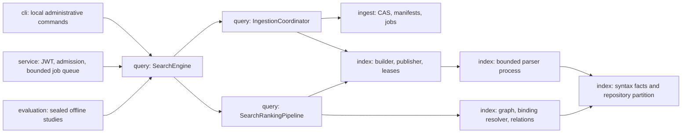
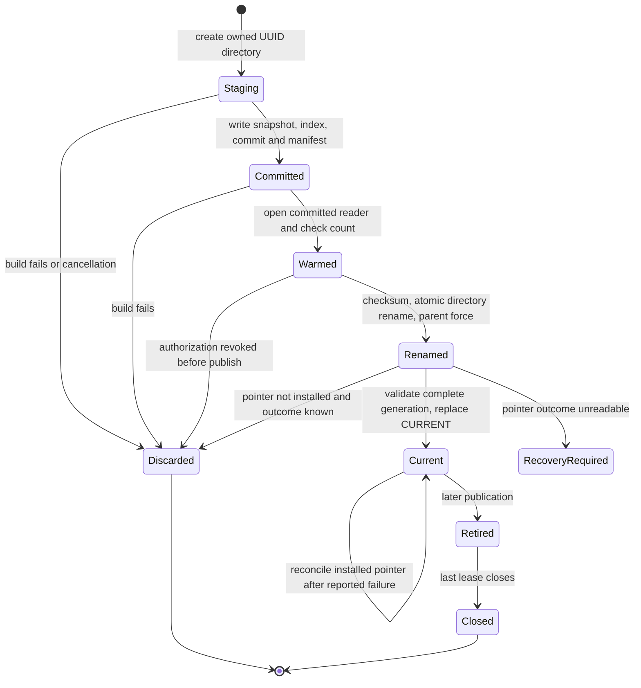
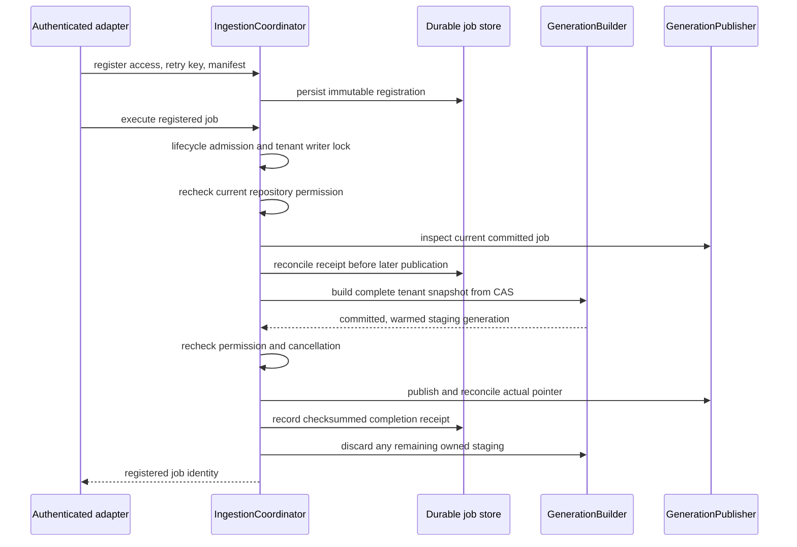
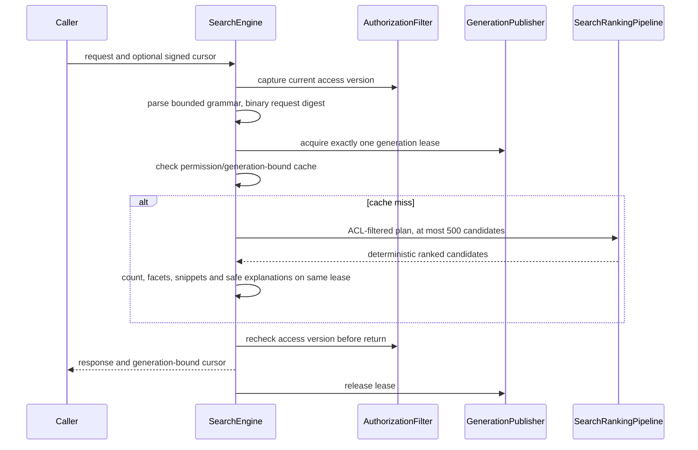
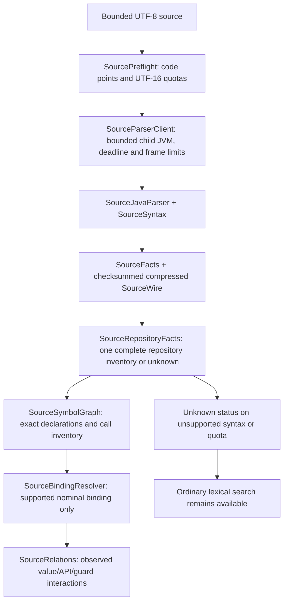

# Architecture

IndexForge is a local, multi-tenant source search service over immutable Lucene generations. A tenant has one current generation; a generation contains that tenant's repositories. Retrieval applies repository permissions before collecting candidates. The CLI and HTTP adapter share the same application service. There is no browser UI.

## Module and policy boundaries



| Boundary | Source and responsibility |
| --- | --- |
| Input acquisition | [SafeSourceReader][reader] bounds traversal, strictly decodes UTF-8, and retains root-relative paths. [ArchiveDirectory][archive] validates ZIP directory/local-header identity before the streaming pass. [SnapshotManifest][manifest] owns canonical input identity; [ContentAddressedStore][cas] owns bounded digest-verified objects. |
| Durable ingestion | [IngestionCoordinator][coordinator] owns the OS data-directory lock, per-tenant writers, job reconciliation, staging disposal, and shutdown admission. [GenerationBuilder][builder] owns one staging tree. [GenerationPublisher][publisher] owns pointers and reader lifetimes. |
| Serving policy | [SearchEngine][engine] coordinates request authorization, one reader lease, counts, facets, snippets, cache and cursor context. [SearchRequestIdentity][identity] encodes the versioned binary request identity. [SearchRankingPipeline][pipeline] applies the same retrieval, feature, ablation and usage policy to serving and label-blind exports. |
| Source observations | [SourceJavaParser][parser] records declarations and bounded executable syntax. [SourceSyntax][syntax] projects expressions; [SourceCompilerBoundary][compiler] denies compiler file resolution. [SourceSymbolGraph][graph] owns repository inventory and graph aggregation; [SourceBindingResolver][binding] owns nominal receiver and overload resolution. [SourceRelations][relations] derives observed interactions. |
| Adapters and studies | [SearchController][controller] owns HTTP queue/task lifetime and tenant-scoped metrics. [IndexForgeCli][cli] validates commands before opening data. [EvaluationJudgments][judgments] filters splits before interpreting query text or grades; [EvaluationSeal][seal] binds the final model before held-out execution. |

Wave2 and wave3 share bounded, non-overwriting phase identity/path records; duplicate keys and escape coercion are rejected consistently. Offline phase identity binds complete inference origins and the complete evaluation origin, including extracted and future helpers; a human-readable phase name cannot replace executable provenance.

These boundaries keep filesystem ownership separate from response construction, binding decisions separate from graph aggregation, and serving policy shared with audit exports. They do not change manifest, cursor, source-facts or model wire schemas.

## Persistent data

```text
DATA/
  OWNER.lock                   one application owner (OS lock)
  cursor.key                   persistent cursor signing secret
  cas/                         SHA-256-addressed source objects
  jobs/                        immutable manifest registrations and .done receipts
  index/TENANT/
    CURRENT, PREVIOUS          generation id + generation checksum + pointer checksum
    checkpoints/              bounded progress hints, never authoritative input
    staging/GENERATION/       build-owned, invisible to search
    generations/GENERATION/   committed Lucene files and snapshot/manifest checksums
    quarantine/               rejected pointers and incomplete startup staging
    source-workers/           deterministic parser bundle and disposable process files
```

The stable document key is `tenant/repository/canonical-relative-path`. Selecting `src/A.java` alone or selecting the full source root gives the same key. An upload's idempotency key is scoped to tenant and repository and binds the immutable manifest digest. A changed manifest under the same key conflicts. Partial uploads preserve unmentioned paths; complete uploads require explicit deletion of every absent earlier path in that repository.

Generation metadata binds schema, generation, count, complete snapshot digest, manifest digest and committed job. Structural generations also bind source-facts/graph schemas, parser bundle identity and JDK runtime version. A completion receipt binds schema, job, manifest and generation. Checkpoints are validated hints: resume rebuilds persisted input instead of trusting a record offset or rereading the original checkout.

## Publication and recovery



[Publication][publisher] validates that a built directory belongs to its exact staging namespace before moving it. It records the old pointer as `PREVIOUS`, then replaces `CURRENT` atomically. An exception after replacement can still mean success: the publisher rereads the actual pointer, adopts a validated installed reader, and allows the coordinator to reconcile the job receipt before another writer. An unreadable ambiguous pointer blocks writes until restart; the generation files remain intact.

A failed first publication removes its unreferenced renamed directory. Without that cleanup, startup would see committed files without either pointer and correctly refuse to guess. Startup validates `CURRENT`, then `PREVIOUS`; it repairs `CURRENT` from a valid fallback before exposing that reader. A failed repair is an operational startup failure and preserves the valid fallback. Incomplete staging moves to quarantine.

The publisher retains current, previous and externally leased generations. A retired generation cannot acquire new leases; existing leases remain valid until release. Cursors do not pin readers: a requested retired generation returns `410`. CAS and job retention are separate operator responsibilities.



The lifecycle write lock waits for admitted writers during shutdown. Before closing any publisher, the coordinator freezes new lease admission on every publisher. A publisher with a live lease rejects shutdown; earlier freezes are rolled back and the data-directory lock stays owned. Once admission is frozen everywhere, all readers are closed and the OS lock is released. The HTTP adapter cancels and joins its build tasks before the engine is destroyed.

This protocol requires same-filesystem atomic rename and directory-force support on local storage. Exception injection and `/dev/full` tests cover reported filesystem failures; they do not establish hardware power-loss behavior or distributed-filesystem durability.

## Search, ranking and authorization



[QueryAst](../query/src/main/java/io/github/cheshmakzanoon/portfolio/indexforge/QueryAst.java) accepts uppercase `AND`, `OR`, unary `NOT`, parentheses, phrases and allowlisted fields. Adjacent terms use `OR`; `AND` binds more tightly. Wildcard, fuzzy and range operators are rejected; terms remain literal input to the configured analyzers. Query text is limited to 512 UTF-16 units, 64 lexical tokens and depth 8; the planned query is limited to 768 terms. Pages contain at most 100 hits; retrieval/reranking sees at most 500 authorized candidates. Exact counts can scan more matches than the candidate window. Feature scoring allocates ordinal storage to the admitted candidate count, sorts by index document for monotonic scorer traversal, then writes scores back to the original candidate positions.

The 128-page cache has typed access/generation/request/offset keys. It stores immutable page content and a continuation offset, then signs a fresh expiring cursor for every response. A frequently reused page cannot retain an already expired continuation token. [SearchRequestIdentity][identity] preserves the v2 length-prefixed UTF-16 encoding and sorted filter tuples, avoiding delimiter collisions without changing existing cursor identities. Cursor authentication also binds principal, tenant, permission version, generation, offset and expiry. Cache hits still acquire a lease and recheck access before returning.

Snippet placement matches literal query text against the original source, avoiding offset drift from Unicode case expansion; truncation preserves complete surrogate pairs. Snippets are plain text and do not affect retrieval membership.

Identifier analysis emits normalized whole identifiers and bounded components at original source offsets. Both analyzed terms and exact declaration hints apply Lucene's32,766-byte term bound after lowercase normalization. An oversized term is omitted whole; complete original source stays stored. This prevents a large legal declaration from turning an otherwise admitted source document into a failed index build.

Optional source strategies remain experimental. The complete inference artifact and actual numeric profile participate in the scoring identity. The source audit and serving paths use the same ablation checks; disabling identifiers/code features/member usage cannot silently reenable usage reranking in an export. [Relevance limitations and failed measurements](PERFORMANCE.md) remain part of the adoption decision. The deployed default remains `CLASSIC/BASELINE/CURRENT`.

Permissions constrain results, counts, facets, suggestions, snippets, explanations, cache reads and source partitions. Metrics expose only the authenticated administrator's tenant. BM25 collection statistics still span repositories within one tenant, so scores/order can depend on inaccessible repositories. The [security model](SECURITY.md) describes this statistical confidentiality limit.

## Source observations and abstention



The parser uses javac's parse phase with processing disabled and compiler file resolution denied; it does not compile, attribute types, load submitted classes or run builds. Source is consumed as code points while identifier quotas use UTF-16 units, matching facts and wire validation. The deterministic parser bundle includes its syntax and compiler-boundary classes; moving those responsibilities changes the bundle identity and requires an explicitly rebuilt matching API catalog and structural generation.

The binding resolver supports a conservative subset of nominal types and exact overloads. Unknown receivers, inheritance, ambiguous overloads and incomplete inventories abstain. Enums with constant-specific bodies do not establish exact virtual dispatch; a constant may override the method. Static/private calls remain eligible where their other preconditions hold. The usage lane admits identifiers up to 128 UTF-16 units; longer valid identifiers bypass it and remain ordinary lexical queries.

Relations describe observed bounded syntax/value interactions, not control-flow dominance, runtime safety, taint analysis or whole-program call-graph completeness. JDK API prose comes from the installed, identity-bound source catalog and retains its license. Unsupported source evidence is unknown; it is not fabricated as zero callers or absence of behavior. Derived relation quotas can suppress that feature family without changing declaration membership.

[reader]: ../ingest/src/main/java/io/github/cheshmakzanoon/portfolio/indexforge/SafeSourceReader.java
[archive]: ../ingest/src/main/java/io/github/cheshmakzanoon/portfolio/indexforge/ArchiveDirectory.java
[manifest]: ../ingest/src/main/java/io/github/cheshmakzanoon/portfolio/indexforge/SnapshotManifest.java
[cas]: ../ingest/src/main/java/io/github/cheshmakzanoon/portfolio/indexforge/ContentAddressedStore.java
[coordinator]: ../query/src/main/java/io/github/cheshmakzanoon/portfolio/indexforge/IngestionCoordinator.java
[builder]: ../index/src/main/java/io/github/cheshmakzanoon/portfolio/indexforge/GenerationBuilder.java
[publisher]: ../index/src/main/java/io/github/cheshmakzanoon/portfolio/indexforge/GenerationPublisher.java
[engine]: ../query/src/main/java/io/github/cheshmakzanoon/portfolio/indexforge/SearchEngine.java
[identity]: ../query/src/main/java/io/github/cheshmakzanoon/portfolio/indexforge/SearchRequestIdentity.java
[pipeline]: ../query/src/main/java/io/github/cheshmakzanoon/portfolio/indexforge/SearchRankingPipeline.java
[parser]: ../index/src/main/java/io/github/cheshmakzanoon/portfolio/indexforge/SourceJavaParser.java
[syntax]: ../index/src/main/java/io/github/cheshmakzanoon/portfolio/indexforge/SourceSyntax.java
[compiler]: ../index/src/main/java/io/github/cheshmakzanoon/portfolio/indexforge/SourceCompilerBoundary.java
[graph]: ../index/src/main/java/io/github/cheshmakzanoon/portfolio/indexforge/SourceSymbolGraph.java
[binding]: ../index/src/main/java/io/github/cheshmakzanoon/portfolio/indexforge/SourceBindingResolver.java
[relations]: ../index/src/main/java/io/github/cheshmakzanoon/portfolio/indexforge/SourceRelations.java
[controller]: ../service/src/main/java/io/github/cheshmakzanoon/portfolio/indexforge/SearchController.java
[cli]: ../cli/src/main/java/io/github/cheshmakzanoon/portfolio/indexforge/IndexForgeCli.java
[judgments]: ../evaluation/src/main/java/io/github/cheshmakzanoon/portfolio/indexforge/EvaluationJudgments.java
[seal]: ../evaluation/src/main/java/io/github/cheshmakzanoon/portfolio/indexforge/EvaluationSeal.java
