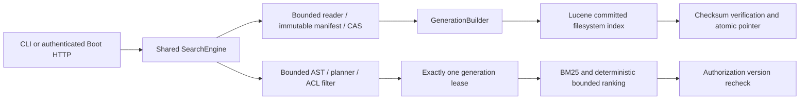

# Architecture and guarantees

`ingest` has no Lucene or server dependency. `index` owns actual Lucene directory lifetimes and commits. `query` owns server-side access mappings, original grammar, field weighting, signed cursors and application services. `service` is an HTTP/security/job adapter. `cli` and `evaluation` call the same query application services. No production module imports another portfolio project.

Each stable key is tenant/repository/canonical relative path. Input manifests are immutable schema-tagged binary values with canonical entry order. CAS validates SHA256 on both existing writes and reads. A tenant's index is physically under `index/TENANT/`; a generation includes its complete immutable snapshot metadata, the registered input manifest, committed Lucene metadata, and a checksum over stable files. Partial uploads merge with prior committed state; complete uploads must explicitly name every deletion. Retry keys are scoped to tenant/repository and canonical manifest hash.

Publication builds in sibling staging, commits the writer, opens and warms a committed reader, validates counts/content hashes/full-snapshot hashes, renames staging to a generation, saves PREVIOUS then atomically replaces CURRENT. Pointer payloads are checksummed. File and directory metadata are forced. Unsupported atomic move/directory force is a hard failure. The tested durability model is a local Linux filesystem with same-filesystem rename; this is not a claim about remote/object filesystems, lying storage controllers, or arbitrary power-loss hardware. On startup CURRENT is validated, then PREVIOUS; incomplete staging is quarantined. If neither pointer validates while committed files exist, startup fails explicitly and preserves files for operator recovery.

Requests acquire exactly one committed generation lease. Old readers retire after publication and close after outstanding leases close. Files retain current/previous and leased older generations; older unleased files are reclaimed. Pagination is a bounded500-candidate window; a signed cursor into a reader that has retired returns410. A cursor does not indefinitely pin a snapshot. CAS and immutable job retention currently require operator retention policy; they are not automatically garbage collected.

The parser implements uppercase AND/OR/NOT, parentheses, quoted phrases and an allowlisted set of exact fields; ordinary adjacent terms use OR for natural-language retrieval. AND binds more tightly, NOT is unary, adjacent NOT restricts the preceding expression. Limits are512 characters,64 tokens and depth8. Identifier analysis lowercases Unicode using Locale.ROOT, preserves the complete identifier with offsets, and emits acronym/camel-case/underscore pieces at the same token position. Original symbol spelling is stored separately; tenant/repository/path identities remain case sensitive. Phrase positions reflect source words; identifier pieces are synonym-position alternatives.

Lucene supplies BM25. The original planner weights content1, split identifiers3, exact symbols8, path pieces2, and conservative exact Java declarations32 for a whole single-identifier query; an additional prose field uses Lucene English stopword/Porter filters at1.5; baseline uses content only; ablations remove the weighted identifier/declaration channels, path features, or added prose field. Baseline content analysis retains the original identifier tokenizer. Candidate selection is bounded500 and deterministic score/key ordering; score explanations export only matching authorized-document field/term features, numeric score and reranking bonuses; raw Lucene collection statistics are withheld. The original reranker examines at most500 authorized candidates, adds4 for an indexed exact Java declaration and2 for an exact source-file stem, then applies score/key tie-breaking. The bounded declaration-hint scanner skips comments/string/char/text blocks, recognizes type names and typed method signatures, rejects ordinary calls, and caps input1MiB,100000 lexical tokens,1024 signature tokens and256 hints per document. This is a conservative lexical hint, not a complete Java grammar or compiler. Declaration features were added after preliminary development/validation failures and before any held-out measurement; identifier/path ablations disable corresponding features; explanations include their bonuses. No learned embeddings or external search server exists.

A complete generation is capped at128MiB aggregate UTF8 source bytes in addition to the100k document and64MiB metadata quotas. Upload acquisition has a separate256MiB total limit; a successful bounded upload can still be rejected when its complete tenant generation would exceed the tighter retained-state budget. Preflight subtracts deletions/replacements before reading new CAS source text; startup verifies the same aggregate. Candidate retrieval/ranking/suggestion stages load only required stored metadata; final authorized hits read source for snippets.

Response cache capacity128; keys contain tenant, principal, exact allowed repository set, authorization version, generation, query/filter/mode digest and page offset. Every cache hit still acquires a lease and rechecks the current authorization version. Counts and repository facets use the same authorized query. Suggestions use an authorized symbol prefix query and version recheck. No constant-time confidentiality is claimed for shared hardware.

Directory and selected-file ingestion preserve paths relative to the configured repository source root. Selecting `src/Foo.java` after a full-root snapshot replaces `src/Foo.java`; selecting `src` does not rebase it to `Foo.java`. ZIP entries retain their declared normalized repository-relative names. Root binding is therefore part of ingestion identity, and HTTP selects within the authorized tenant/repository source root.

Optional handwritten concept associations apply only to plain multiword queries and are disabled for explicit Boolean, phrase, field and single-identifier queries. At most6 groups contribute4 additional terms each, with two independently triggered groups required when available. This catalog was authored using ordinary software terminology and observed development/validation failures, not an external thesaurus. Generation/snapshot/version and lease/reader/retire are associations, not synonyms. The frozen catalog/provenance is in fixtures/CONCEPTS-v1.md; NO_CONCEPTS is retained as an ablation. Held-out data has not influenced the catalog.

The pending coverage/weight experiment is preregistered in fixtures/WEIGHT-COVERAGE-v1.md: six fixed presets and a distinct normalized query-term coverage bonus. Prose term vectors avoid reloading full source for500 candidates. Coverage changes scores only for ordinary multiword queries, and NO_COVERAGE/NO_PROSE/BASELINE disable it. Profile is captured once per engine, included in scoringVersion and compiled evaluation identity. CURRENT preserves previous weights and has coverage0. Validation selection must preserve both baseline nDCG and identifierMRR before maximizing the weaker ratio to the declared .75/.90 targets. STATUS distinguishes pending code from certified evidence.
