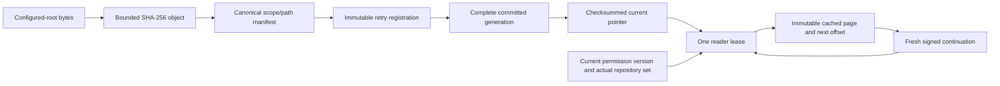

# Stacks invariants

| Identity | Bound fields | Enforcement |
| --- | --- | --- |
| Content object | Lowercase SHA-256 and at most 1 MiB original bytes | [ContentAddressedStore](../ingest/src/main/java/io/github/cheshmakzanoon/portfolio/stacks/ContentAddressedStore.java) verifies object admission/digests; source text decoding rejects malformed UTF-8. |
| Snapshot | Schema, tenant, repository, revision, canonical paths, content digests, metadata and deletions | [SnapshotManifest](../ingest/src/main/java/io/github/cheshmakzanoon/portfolio/stacks/SnapshotManifest.java) fixes serialization/order before hashing. |
| Job/receipt | Repository-scoped retry key, immutable manifest digest; completed schema/job/manifest/generation checksum | [IngestionJob](../ingest/src/main/java/io/github/cheshmakzanoon/portfolio/stacks/IngestionJob.java) and [IngestionCoordinator](../query/src/main/java/io/github/cheshmakzanoon/portfolio/stacks/IngestionCoordinator.java) reconcile before later publication. |
| Generation | Full snapshot and manifest digests, schema, count, job and generation; optional source schemas/parser/JDK | [GenerationBuilder](../index/src/main/java/io/github/cheshmakzanoon/portfolio/stacks/GenerationBuilder.java) commits; [GenerationPublisher](../index/src/main/java/io/github/cheshmakzanoon/portfolio/stacks/GenerationPublisher.java) validates before exposure. |
| Request/cache/cursor | Length-prefixed text, sorted filters, page size, mode/scoring identity; actual access scope/version, generation, offset and expiry | [SearchRequestIdentity](../query/src/main/java/io/github/cheshmakzanoon/portfolio/stacks/SearchRequestIdentity.java), [SearchEngine](../query/src/main/java/io/github/cheshmakzanoon/portfolio/stacks/SearchEngine.java) and [SearchCursor](../query/src/main/java/io/github/cheshmakzanoon/portfolio/stacks/SearchCursor.java). |

| Boundary | Invariant | Implementation and evidence |
| --- | --- | --- |
| Input identity | Stable key is tenant/repository/configured-source-root-relative path, preserved for nested file/directory selections; immutable manifest hash and repository-scoped retry key identify the same job. Changed content under the same key conflicts. | SnapshotManifest canonical constructor/serialization; IngestionJob durable registration; 10,000-record retry and manifest round-trip tests. |
| Durable job outcome | A committed job cannot replay over a later revision, even when publication returned an unknown outcome. Completion receipts bind schema/job/manifest/generation and verify checksums before status or retry. | Commit-metadata reconciliation before startup/later tenant publication; AFTER_POINTER/RETIRE × live/restart A→B→resumeA and corrupt receipt status/resume/startup regressions. |
| Input acquisition | Explicit source selection never executes source/builds/classes. UTF-8 decoding is strict; file, traversal, aggregate, archive expansion and metadata work have quotas. HTTP selection stays under server-authorized SOURCES/TENANT/REPOSITORY. | SafeSourceReader, ContentAddressedStore, HTTP source-binding and symlink regressions; malformed ZIP EOCD/central-directory/local-header identity; directory payloads cannot bypass expanded-byte bounds. Parent-directory replacement by a malicious local administrator is outside the model. |
| Snapshot replacement | Partial input preserves unmentioned documents. Complete input must explicitly delete every absent document in that repository. Unrelated repositories retain identity and revision. | GenerationBuilder merge and fullSnapshot metadata; deletion/partial tests and reindex revision regression. |
| Authoritative recovery | Immutable manifest, CAS digests and committed index metadata determine content. Progress checkpoints are validated hints and never authorize skipping source records. | CheckpointStore bounds/checksum; GenerationBuilder validates hint then rebuilds from authoritative records; resume after original input deletion. |
| Durable publication | A visible generation is a committed, warmed, checksum/count/content/snapshot-verified reader. CURRENT changes through same-filesystem atomic rename after file/directory sync. | GenerationBuilder, GenerationPublisher; 100 seeded failure schedules and corrupt-current fallback tests. Filesystem must support these primitives; power-loss hardware behavior is not inferred from exception injection. |
| Live reader lifetime | One request leases exactly one committed reader for candidates/count/facets/snippets/explanations/cursors. Publication retires old acquisition, while existing leases remain valid until close. | GenerationLease reference counts; old/new lease tests, paused-writer availability regression, post-pointer-failure retirement/refcount/pruning tests. |
| File lifetime | CURRENT/PREVIOUS generation files remain available for recovery; leased older files remain until last close. Other committed files may be pruned. CAS/job history requires separate operator retention. | GenerationPublisher publish/release/startup cleanup. Multi-publisher shutdown freezes new lease admission before closing readers. A rejected close rolls back freezes and retains ownership. Failed first-publication directories are discarded; a failed fallback-pointer repair preserves PREVIOUS and fails startup. No distributed reader ownership is claimed. |
| Tenant/repository authorization | Permission predicates precede retrieval, counts, facets, suggestions, snippets and explanations. Cache context includes permissions/version/generation/query/page, with a version recheck before return. | AuthorizationFilter and SearchEngine; real populated foreign-tenant/denied-repository fixtures and warmed-cache revocation tests. A permission update after the final recheck is a later policy event. Raw Lucene collection statistics are omitted from explanations; tenant-reader BM25 scores/order retain statistical coupling across repositories, explicitly documented in SECURITY. |
| Authenticated tenant continuity | A search or suggestion request retains its admitted principal/tenant across every grant refresh. A current mapping in a different tenant is denied; captured repository grants never supersede the server directory. | TenantBoundSearchTest covers admission, stale grants, fresh/cached final checks and same-tenant refresh. ControllerTenantAdmissionTest changes mappings during JWT-context admission; TenantReassignmentHttpIT pauses signed HTTP requests at original-tenant reader acquisition and verifies `403` after reassignment. |
| Cursor continuity | Signed cursor binds principal/tenant/permission version/query digest/generation/offset/expiry. A cached page signs a fresh cursor from its saved continuation offset; cached content never retains a time-limited token. A retired requested generation returns `410`; a cursor never pins a reader indefinitely. | SearchCursor authenticated encoding/decoding and tamper/context/expiry/retirement tests. |
| Bounded query work | Input ≤ 512 UTF-16 units, 64 lexical tokens, depth 8, page ≤ 100, candidates ≤ 500, suggestions ≤ 20, cache ≤ 128 pages, explanation ≤ 4,096 UTF-16 units, complete query plan ≤ 768 terms. Optional coverage uses ≤ 64 distinct query terms and only authorized document term vectors; explicit query syntax disables it. | QueryAst, Request, CandidateRetriever, SearchEngine and explanation/cache regression. Exact counts may scan more matches than the candidate window. |
| Bounded adapters | Raw HTTP body ≤ 65,536 bytes before conversion; 32 admitted requests; 2 build workers and 8 queued jobs. Ingestion/resume/reindex share admission. Data directory has one application owner. Tenant-admin metrics contain only that tenant's activity. HTTP shutdown joins its build tasks before engine destruction. | AdmissionFilter, SearchController, DataDirectoryLock; oversized raw-body wire test and data-lock/recovery tests. Source acquisition precedes queued index building and remains within request/input quotas. |
| Token authenticity | RS256 crypto/issuer/time checks precede raw signed JSON claim-type checks. Subject/tenant/audience/expiry/search scope are required; repository permissions come from server mapping. | SecurityConfiguration and actual live-JWKS HTTP negatives, including signed numeric/array/null/blank subjects. CLI uses trusted local filesystem administration. |
| Evaluation independence | The frozen 80 graded queries and 40/20/20 split cannot be relabeled based on scores. Development filters the split before parsing query text/grades. Selection binds model bytecode and frozen data before the final seal and held-out parsing/execution. | Corpus review, FREEZE.sha256, selection.txt, and HELDOUT-OPENED.txt. Both published final candidates failed the quality guard; baseline is retained. Repeated held-out exposure is disclosed. |

[Validation status](STATUS.md) records the executed regression sets and commands. ENOSPC integration uses a real `/dev/full` kernel failure at the pointer boundary; it does not claim the actual index filesystem was filled.

## Quota units and unknown observations

| Data/work | Bound and unit | Result when exceeded |
| --- | --- | --- |
| Input source object | 1,048,576 bytes; strict UTF-8 | Reject acquisition/CAS write; no oversized persistent object. |
| Acquired snapshot | 256 MiB source bytes; 100,000 traversal/entry limit | Reject acquisition, independently of the smaller retained-generation quota. |
| Ordinary ZIP | At most 65,534 entries; 1 MiB per expanded member; 100:1 default total expansion ratio | Reject before publication. Directory members consume bounded reads and must be empty. |
| Complete tenant generation | 100,000 documents; 128 MiB retained UTF-8 source; 64 MiB snapshot metadata | Reject the build and discard its owned staging tree. |
| Structurally parsed unit | 65,536 source bytes; 8,192 preflight tokens; nesting 32; identifier 256 UTF-16 units | Entire unit has an explicit unknown/quota/syntax status; lexical source remains searchable. |
| Source wire frame | 16,384 serialized bytes; 262,144 expanded bytes; expression depth 8 | Reject malformed frames or abstain at the parser boundary. |
| Repository source partition | 32 MiB serialized; 8 MiB decoded; 65,536 members; 262,144 calls | Inventory is unknown as a whole rather than an apparently complete prefix. |
| Identifier usage query | 128 UTF-16 units; caller counts capped at 32 | Longer identifiers bypass this optional lane; uncertain graphs do not become zero-call evidence. |
| Study identities/seals | 16 KiB phase identity; 4 KiB final decision, measured in UTF-8 bytes | Refuse before writing a self-invalid packet/claim. |

The [architecture](ARCHITECTURE.md) links each enforcement boundary to its implementation. Source membership, exact binding and derived relation evidence are separate claims; success at one boundary does not imply success at the next.
