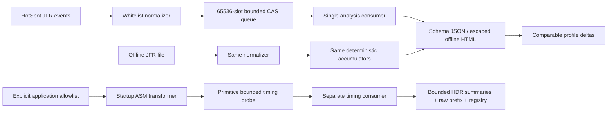

# Architecture

`probe` has only JDK dependencies. Its MPSC ring contains primitive arrays, an atomic publication sequence and a bounded producer CAS loop; no argument/object references are retained. Method IDs are registered during transformation and capped at 10,000. Identity hashes derive from the full signature even when display strings must be truncated.

`agent` adds ASM, relocated in the packaged JAR. AdviceAdapter preserves the operand stack for every return width. An appended catch-all follows original handlers, times escaping exceptions and rethrows the same object. Metadata resolution reads `.class` resources; it never calls Class.forName. Unavailable metadata skips transformation. Scope failures increment fixed reason counters.

`jfr` discovers event schemas, applies a minimal recording configuration, normalizes only supported explicit fields, and handles live RecordingStream callbacks. The callback normalizes a maximum of 128 bounded frames then makes a nonblocking queue offer. A separate consumer aggregates and checks directory budgets. RecordingStream.stop drains callbacks before an offline-equivalent dump. Budget-triggered termination exposes a stop reason; observed loss and consumer/normalization failures mark retained windows incomplete.

`analysis` implements a bounded prefix trie, separate inclusive/self sampled-method totals, fixed half-open event-time windows, weighted allocation counts, bounded HDR histograms for monitor/park/selected timings, and a paired log-ratio comparator. Recursive methods count once per sample in method inclusive totals; each recursive prefix remains a separate flame node. Duration totals belong to event-start windows, so a long event is not divided across buckets. Recursion and cardinality overflow have explicit tests.

`report` owns schema-shaped JSON, text escaping, offline navigable flame stacks and accessible tables. It declares units, denominators, known settings, observation windows and missing evidence. `cli` hashes recording inputs, imports/analyzes, compares and orchestrates subprocess experiments. `workloads` supplies named planted causes on platform and virtual threads. `compatibility` verifies bytecode and host survival in independent JVMs.

The timing consumer aggregates accepted events for up to128retained subjects into HDR distributions; subject overflow is counted and marks output incomplete. Only a bounded10,000-row diagnostic prefix is emitted as per-event TSV; canonical summaries and compressed histograms are written on shutdown. This avoids output growth proportional to invocation rate×recording duration while retaining observed distributions and explicit queue/shutdown loss.
