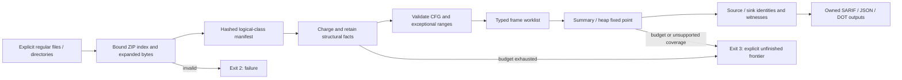
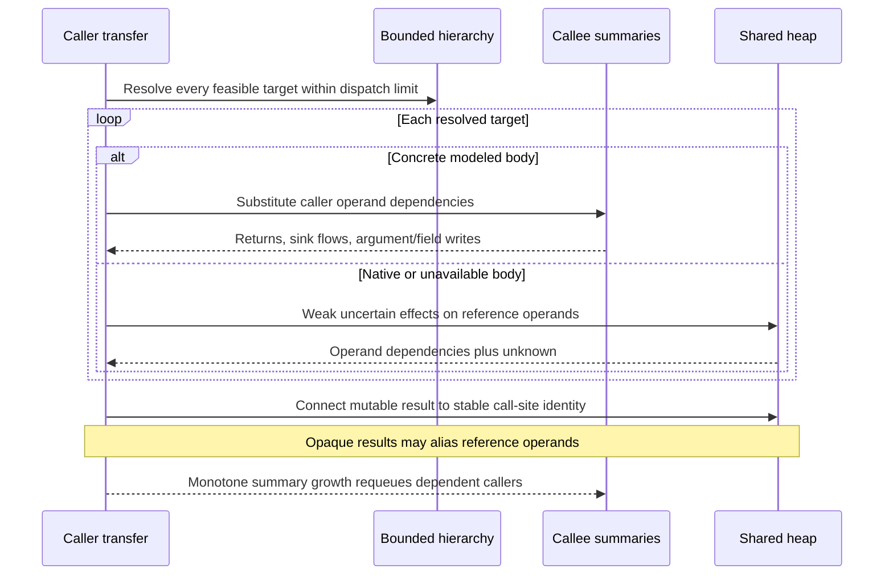

# Architecture and guarantees

ByteGuard computes bounded source-to-sink dependencies from explicit local classfiles. ASM supplies structural nodes; the project owns control-flow construction, computational values, heap summaries, fixed-point scheduling and reporting. It does not load or execute analyzed classes.

| Boundary | Source and responsibility |
| --- | --- |
| Local input | [BoundedJarReader](../analysis-core/src/main/java/io/github/cheshmakzanoon/portfolio/byteguard/input/BoundedJarReader.java) counts every selected entry and actual expanded byte. [ArchiveDirectory](../analysis-core/src/main/java/io/github/cheshmakzanoon/portfolio/byteguard/input/ArchiveDirectory.java) validates bounded ZIP/ZIP64 index metadata before `ZipFile` allocates its index. No extraction occurs. |
| Structural facts | [BoundedFactsVisitor](../analysis-core/src/main/java/io/github/cheshmakzanoon/portfolio/byteguard/bytecode/BoundedFactsVisitor.java) charges facts before ASM tree retention, rejects duplicate declarations and validates whole descriptors. [MethodIr](../analysis-core/src/main/java/io/github/cheshmakzanoon/portfolio/byteguard/bytecode/MethodIr.java) assigns opcode ordinals and indexes all label targets once. |
| Intraprocedural state | [ControlFlowBuilder](../analysis-core/src/main/java/io/github/cheshmakzanoon/portfolio/byteguard/cfg/ControlFlowBuilder.java), [FrameState](../analysis-core/src/main/java/io/github/cheshmakzanoon/portfolio/byteguard/dataflow/FrameState.java), [TransferFunction](../analysis-core/src/main/java/io/github/cheshmakzanoon/portfolio/byteguard/dataflow/TransferFunction.java) and [WorklistSolver](../analysis-core/src/main/java/io/github/cheshmakzanoon/portfolio/byteguard/dataflow/WorklistSolver.java) own edges, typed operands, joins and propagation. |
| Calls and recursion | [TypeHierarchy](../analysis-core/src/main/java/io/github/cheshmakzanoon/portfolio/byteguard/bytecode/TypeHierarchy.java) resolves bounded dispatch alternatives. [SummaryWorklist](../analysis-core/src/main/java/io/github/cheshmakzanoon/portfolio/byteguard/interprocedural/SummaryWorklist.java) schedules SCCs and callers until summaries and shared heap stop growing. |
| Coverage | [Analyzer](../analysis-core/src/main/java/io/github/cheshmakzanoon/portfolio/byteguard/interprocedural/Analyzer.java) retains completed parser facts while naming every unstarted concrete-method obligation if parsing exhausts its budget. [AnalysisBudget](../analysis-core/src/main/java/io/github/cheshmakzanoon/portfolio/byteguard/interprocedural/AnalysisBudget.java) separates work/deadline, facts and frame-cell bounds. |
| Output | [FindingReporter](../report/src/main/java/io/github/cheshmakzanoon/portfolio/byteguard/report/FindingReporter.java), [StableIdentity](../report/src/main/java/io/github/cheshmakzanoon/portfolio/byteguard/report/StableIdentity.java) and [OwnedOutput](../report/src/main/java/io/github/cheshmakzanoon/portfolio/byteguard/report/OwnedOutput.java) preserve identity and replace owned directory entries without truncating linked targets. [OutputGuard](../cli/src/main/java/io/github/cheshmakzanoon/portfolio/byteguard/cli/OutputGuard.java) protects inputs/configuration before analysis or error reporting. |

`byteguard-analysis-core` has no Spring, scanner framework, target classloader or ASM Analyzer dependency. `byteguard-report` adds Jackson, `byteguard-cli` adds picocli, and `byteguard-evaluation` compiles only trusted fixtures with annotation processing disabled.

## Parsing and control flow

A ZIP must have a complete, internally bounded central directory and end record; ZIP64 indexes remain supported. Metadata is capped at 16 MiB before index allocation. Actual entry reads enforce expanded-byte and per-entry caps and verify CRC/size, including directory payloads. Split/encrypted archives, symlink entries, traversal names, duplicates, nesting and incompatible class versions fail. Multi-release selection requires an unambiguous manifest flag and chooses the highest supported version at or below the target release. Application/classpath duplicate ambiguity fails instead of depending on path order.

Method ordinals count real opcodes. A reverse metadata index makes branch, switch and exception-label lookup constant time, preventing repeated walks through an adversarial line table. Exception ranges are validated even if their protected instructions cannot throw. Handler transfer preserves pre-instruction locals and replaces the stack with one reference. Incoming and outgoing stack usage must fit `maxStack`. Reachable fall-through, missing concrete bodies and unsupported computational-kind operations fail; native/abstract declarations remain structural facts.

Stack joins require equal height and compatible computational kinds. Local slots merge to unusable TOP when branch-local kinds disagree; a subsequent load of that slot fails. Long/double values occupy two local slots and one computational stack value. Overlapping writes invalidate the appropriate category-two slots. These checks are part of the supported transfer model, not complete JVM verification: constructor initialization rules, access/linkage verification and arbitrary reference-type assignability remain outside it.

## Dependencies, heap and opaque calls

Taint is a finite map from source/parameter identities to three context bits plus an independent unknown bit. Join unions identities and ORs bits. Exact sanitizer contracts remove only their context bit; uncertainty is retained. Witness paths have a separate depth bound and a deterministic, tuple-aware ordering; their length never drives taint convergence.

Native dispatch alternatives remain present alongside clean overrides; missing code cannot certify sanitization. [InvocationEffects](../analysis-core/src/main/java/io/github/cheshmakzanoon/portfolio/byteguard/dataflow/InvocationEffects.java) centralizes opaque mutation and mutable-result identity. A returned array can therefore retain a later store even when its allocation is unknown, and a write through an opaque alias still reaches the caller's formal write summary. Array length depends on allocation dimensions, not stored element contents.

Field keys include owner, name and descriptor; objects are merged. Allocation, field, formal and mutable-return identities participate in bounded bidirectional weak alias closure. Parameter symbols include the owning method scope to prevent foreign rebinding. One-callsite taint instantiation does not imply a context-sensitive heap: reused helpers/receivers can contaminate a clean call. The frozen corpus and separate false-positive controls measure different things; neither establishes universal soundness or field accuracy.

## Identity and publication

Source labels are length-prefixed. Finding hashes preserve established bytes for ordinary names; delimiter-bearing or unpaired UTF-16 names use a domain-separated, length-prefixed UTF-16 tuple with separate ordinals. This prevents witness/DOT/finding collisions without changing existing ordinary baselines. Source basenames are sanitized into relative SARIF locations; missing debug lines remain absent.

The CLI rejects report/explanation destinations inside scanned directories or aliases of protected files, resolving symbolic parents before `..`. SARIF, JSON and every DOT file use a sibling temporary file and replace the directory entry after successful serialization. Existing symbolic outputs are refused; replacing a hard link leaves its old target inode intact. These boundaries assume an owned output directory and do not defend against another process racing filesystem changes.
