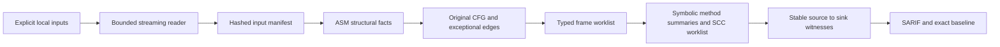

# Architecture and guarantees

`byteguard-analysis-core` uses ASM tree/visitors as a parser and writes all CFG, stack/local transfer, joins, heap abstraction, fixed-point scheduling and summaries itself. It has no Spring, scanner framework, target classloader or ASM Analyzer dependency. `byteguard-report` adds Jackson serialization; `byteguard-cli` adds picocli; `byteguard-evaluation` compiles only owned trusted fixtures and independently evaluates fixed labels.

The input reader streams ZIP entries and never extracts them. Limits cover actual expanded bytes, actual entry counts, per-class bytes, compression ratio, zero nesting, target release, and deadline. Traversal names, duplicate archive names, duplicate logical classes, malformed structural classes and future versions fail. Multi-release selection requires the JAR manifest flag and chooses the highest supported version at or below the target release. Application/classpath duplicate ambiguity is rejected rather than hidden by path order.

Hierarchy and SCC traversal are iterative; hierarchy retains only direct child edges. Setup and solver operations share a global work/deadline budget. Dispatch enumerates only enough targets to establish the configured bound has been exceeded, then reports partial coverage. This is distinct from explanation-depth truncation, which retains all taint facts.

The lattice is a finite map from source/parameter identities to three context bits, plus an independent unknown bit. Join unions identities and ORs bits. Clean bottom has no identities and `unknown=false`; unknown is not clean. Exact sanitizer contracts remove one context bit while preserving uncertainty and the other contexts. Witness paths are bounded separately and never participate in taint termination.

Field keys include declaring class, field name, and descriptor, so fields are sensitive while objects are merged. Array/collection element summaries are conservative; allocation/parameter identities connect references, and argument-element write effects are substituted across calls. Stable field/formal/mutable-return identities and bounded bidirectional weak alias closure preserve field loads, returned arrays and helper mutations. Scalar field-write effects are instantiated in summaries; symbolic parameters include their owning method to prevent rebinding a foreign symbol. Heap aliases merge across callsites independently of one-callsite taint-summary keys, and can contaminate a clean reused-helper call (documented control in the threat model). Aliasing and receiver dispatch are approximate. Unknown/native calls conservatively preserve receiver/argument taints and add uncertainty; a missing summary is never evidence of sanitization.

Parameter-symbolic method summaries are instantiated at caller instruction sites. Return, sink, and argument-element dependencies compose without executing a callee; recursive components reach a monotone fixed point under global limits. Control-dependent implicit flows, reflection effects, native internals, arbitrary bootstrap methods, arbitrary heap graphs, and class initialization order are outside the declared model. Unsupported bootstrap sites produce explicit partial coverage; unresolved calls produce explicit conservative uncertainty.

The core does not certify JVM verification of arbitrary hostile classes: it rejects inconsistent reachable frame shapes and category operations in its supported instruction model, and tests real javac-generated control flow including wide slots and exceptional entries. See the unsupported inventory for remaining verifier/model boundaries.
