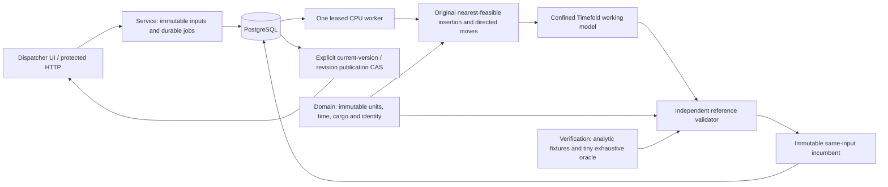

# RouteWeaver architecture

Four Maven modules separate immutable domain snapshots, original planning algorithms and a confined mutable Timefold adapter, the PostgreSQL/Spring HTTP service, and independent verification/oracle/workload drivers. No dependency from domain to Spring or Timefold exists. Each cloud task uses its existing isolated checkout; no worktree is required.

The domain has no solver, Spring or JDBC dependency. Planning depends on domain and confines solver mutation. Service owns HTTP/JDBC and bounded dispatch. Verification depends on implemented modules to run oracle, properties, live scenarios, system workload and JMH; it is not required by the service runtime. A JVM crash loses mutable search state, but the last authoritative immutable candidate and job remain in PostgreSQL. A later generation resumes from durable state and cannot bypass publication CAS.

All deliveries are depot-loaded drops. Distances are integer meters, travel and service use integer seconds, cargo uses integer grams. A service may start at either inclusive window endpoint. Waiting is permitted; service must finish within the vehicle shift and return to the depot within that shift. Maximums are 500 jobs, 25 vehicles, 501 locations, seven-day job windows/shifts, 1,000,000,000 gram loads. Checked long arithmetic accumulates distances, durations, and objectives. Matrix entries are complete and directed. Fixtures contain synthetic coordinates/travel rather than actual Canadian roads.

The objective minimizes lexicographically: hard violation count; sum of unassigned priorities; then meters times `metersWeight` plus travel seconds times `secondsWeight` plus changed assignment/order penalties times `disruptionWeight`. Waiting/service are feasibility inputs, not charged operating travel. Defaults are one cost unit/meter, one/second and 1,000 per changed vehicle or index; every unassigned previously assigned job incurs one disruption penalty. Hard violations never trade against cost. Validation recomputes the full directed route including return arcs and rejects missing/duplicate/overlapping partitions, unavailable cargo, skill/capacity/time/freeze violations. It never calls the solver calculator.

Baseline inserts jobs in descending priority and stable ID order at the feasible insertion with least added directed travel seconds, with stable vehicle/position tie breaks. Local moves recompute all arcs after relocation, swap, and 2-opt reversal. The Timefold adapter assigns job vehicle and order rank; ties use stable IDs. Its independent calculator models the same physical/objective constraints. Every emitted candidate is independently validated and compared to the same immutable input hash only. Wall-clock search is bounded but does not promise repeatable routes; tiny fixtures also use seeded step limits. Tiny oracle recursively includes the unassigned choice and every vehicle insertion position, thus enumerating all assignments and permutations including empty routes. Only exhausted enumeration returns OPTIMUM.

A residual revision records completed history, observed stop location/availability, all onboard jobs and gram load, and frozen remaining prefix. Advancing requires an actual completed route prefix with completion instants at or before the planning instant. Mid-road observations are unsupported. Non-depot vehicles can deliver their own onboard jobs only. New urgent cargo stays at the depot. Failed onboard cargo remains unassigned with STRANDED_CARGO. Releasing failed frozen work requires explicit audited consent in the revision; completed work is immutable. Prior plans must be repaired/revalidated before same-version retention, and are never compared as raw scores across revisions.

PostgreSQL stores immutable inputs/candidate snapshots and all solve metadata. A global admission lock bounds outstanding durable jobs to 17; one CPU worker runs per service process and the local executor is also bounded. SKIP LOCKED claims increment a generation and establish a database-clock lease. Candidate/terminal writes lock the same job row and check legal state, generation, and unexpired lease in one transaction. Stale/invalid candidate snapshots remain diagnostic without replacing a valid incumbent. Lease expiration requeues RUNNING jobs with a new fence, or acknowledges expired CANCEL_REQUESTED as CANCELLED. Startup/polling run recovery; a live lease is never stolen just because a second process starts.

Queued cancellation is direct CANCELLED. Running cancellation becomes CANCEL_REQUESTED and is acknowledged by a cooperative worker as CANCELLED, preserving its incumbent. If completion locks first, terminal completion wins and cancellation is idempotent. Cancellation never publishes. Publication separately locks active input and plan revision and requires current problem/version/hash plus an independently valid terminal incumbent; concurrent revision-CAS attempts have one winner. Historical expired/superseded worker results cannot become the active plan.

Cancellation database reads are sampled at 100 ms and latch termination for that generation. CPU deadline/interruption checks stay on every trial. This caches observation only, never authority: candidate, terminal and publication transactions retain all row-locked state/fence/lease/version checks.
