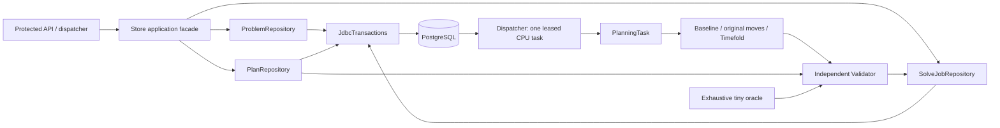
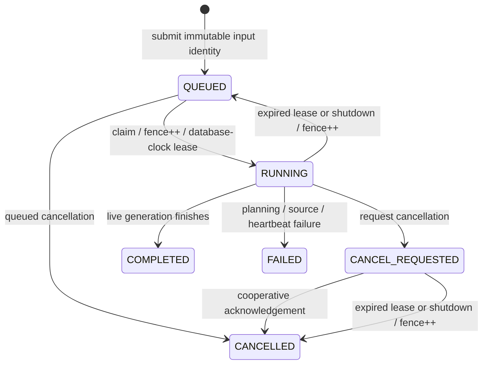

# Switchback architecture

Switchback separates three decisions: whether a route is physically valid, whether a search result improves the same immutable input, and whether that result may become the published plan. A solver score, a live thread, or a previously valid lease cannot substitute for any of those decisions.

## Module boundaries

| Module | Owns | Excludes |
| --- | --- | --- |
| `switchback-domain` | Copied immutable records, integer units, residual cargo/history, input identity and lexicographic score | Spring, JDBC, mutable solver entities |
| `switchback-planning` | Reference validation, deterministic baseline, directed local moves, residual repair and confined Timefold adaptation | Database state and publication |
| `switchback-service` | HTTP authorization, immutable persistence, durable jobs, lease generations and explicit publication | Solving on HTTP threads; trusting submitted scores |
| `switchback-verification` | Exhaustive tiny oracle, analytical/property fixtures, live driver and declared measurement protocols | Runtime dependencies required by the service |



[Store](../switchback-service/src/main/java/io/github/cheshmakzanoon/portfolio/switchback/Store.java) preserves the application-facing records and method signatures. SQL belongs to three package-private repositories; [JdbcTransactions](../switchback-service/src/main/java/io/github/cheshmakzanoon/portfolio/switchback/JdbcTransactions.java) alone acquires connections, applies transaction/lock timeouts, commits, rolls back and binds parameters. A failed rollback is attached to the original failure rather than replacing it. No transaction remains open while the CPU solver runs.

## Domain and independent evaluation

[Model](../switchback-domain/src/main/java/io/github/cheshmakzanoon/portfolio/switchback/Model.java) uses integer seconds, meters and grams. A snapshot contains at most 500 jobs, 25 vehicles and 501 locations; its complete matrix is directed and has a zero diagonal. Lists, nested rows, sets and maps are copied. Route/candidate cardinalities are bounded independently of problem parsing. Previous assignments cannot occupy the same vehicle/index pair. Whole-second input instants reserve enough representational headroom for a maximum-length route, including service and return travel.

A vehicle begins at its observed location and availability with its actual onboard cargo. Depot-loaded drops can add cargo only at the declared depot. Service may start at either inclusive window endpoint; waiting is allowed, but service and the final directed return must finish within the shift. [Validator](../switchback-planning/src/main/java/io/github/cheshmakzanoon/portfolio/switchback/Validator.java) reconstructs every arc, load, skill, window, frozen prefix and assigned/unassigned partition. It calculates cost from raw route orders and never invokes Timefold's calculator.

The objective minimizes hard violations, then weighted unassigned priority, then operating cost plus disruption. Operating cost charges directed meters and travel seconds; waiting/service affect feasibility. [Heuristics](../switchback-planning/src/main/java/io/github/cheshmakzanoon/portfolio/switchback/Heuristics.java) inserts jobs in descending priority/stable identifier order, tries directed-duration insertion deltas, and independently validates complete candidates. Relocation, swap and reversal also reevaluate the full route. Retention requires the same input hash and an independently reconstructed score.

[TimefoldAdapter](../switchback-planning/src/main/java/io/github/cheshmakzanoon/portfolio/switchback/TimefoldAdapter.java) owns every mutable assignment and working solution. The separate search calculator uses epoch-second arithmetic; the reference evaluator uses `Instant` timelines. Solver callbacks emit immutable candidates and must pass the reference validator before replacing the incumbent. Cancellation remains latched across solver startup. Observer failures request termination and propagate to the owning task rather than silently disabling cancellation.

[ExactOracle](../switchback-verification/src/main/java/io/github/cheshmakzanoon/portfolio/switchback/ExactOracle.java) enumerates an explicit unassigned choice and every vehicle insertion position for up to seven jobs/two vehicles. Each invocation owns its search frontier, leaf budget and optimum; a shared oracle instance cannot mix concurrent searches. Only exhausted enumeration returns an optimum. A leaf-limit result is inconclusive and has no optimum.

## Local search before the solver

`Heuristics.improve` runs between the insertion baseline and the Timefold phase. Every candidate it accepts is validated by the independent `Validator` and must strictly lower the lexicographic score (hard violations, unassigned priority, then operating cost plus disruption).

- **Exact cost pruning.** Moves that reassign no job cannot change the hard or unassigned score components, and the soft component is plain arithmetic over the moved routes: weighted directed arcs from the vehicle's position through its stops and back to the depot, plus the disruption weight for stops whose previous vehicle or index changed. `Heuristics.Estimator` computes exactly that change from job-id lists. A move whose soft change is not negative could never be accepted, so it is skipped before a `Route` is built, before validation and before it is counted against the evaluation limit; with an unlimited limit the result is identical to validating every candidate (checked on 30 instances, including ones with disruption), and `new Heuristics(false)` keeps the original accounting. The evaluation limit therefore counts validated, potentially improving candidates.
- **Wider neighbourhoods.** After relocate, swap and intra-route reversal reach a local optimum, `improve` tries Or-opt (two- and three-stop segments, forward or reversed, within or across routes) and cross-route tail exchange, skipping combinations the validator would reject structurally (failed vehicle, missing skill, cargo aboard another vehicle, depot cargo for a moving vehicle, the frozen prefix), and returns to the original moves after any gain. With the same limit it is never worse than `improveBasic`, which keeps only the original moves.

Neither change alters what may be published: the incumbent, fence, lease and publication rules are unchanged, and the estimator is a pruning device that never decides validity or acceptance.

## Durable state and transaction order



A terminal job is never automatically published. Publication can select an independently valid retained incumbent from `COMPLETED` or `CANCELLED`; `FAILED` is diagnostic only. Shutdown requeues interrupted work with a new fence and retains its last incumbent. If shutdown loses database access, lease expiration remains the recovery mechanism.

| Operation | Lock/authority order | Committed effect |
| --- | --- | --- |
| Submit | Global admission advisory lock, active-input row | Idempotent request or a new queued job; at most 17 outstanding globally |
| Claim/recover | Expired job rows, then oldest queued row with `SKIP LOCKED` | New generation and database-clock lease |
| Candidate | Job row; current state/fence/lease; immutable snapshot loaded from that row | Diagnostic candidate; only a live valid candidate may improve the incumbent |
| Cancel/finish | Same job row | One legal ordering of cancellation and completion |
| Release on shutdown | Conditional update of the current generation | Fence increment, lease/owner cleared, requeue or cancellation acknowledgement |
| Publish | Active-input row, plan row, terminal job read, independent validation | One revision CAS winner and audit event |
| Replan | Active-input row, plan row, observed-prefix calculation | New immutable input version and audited residual state |

Candidate validation reads the locked job's problem identity, never a caller-supplied copy. Publication deliberately does not acquire a job row lock after locking the plan: terminal job metadata does not transition back to active work, and candidate snapshots are immutable. This avoids a job-to-plan lock cycle. Input changes can leave an old solve as valid historical evidence, but publication still rejects its version.

```mermaid
sequenceDiagram
  participant UI as Dispatcher
  participant API
  participant DB as PostgreSQL
  participant CPU as Leased task
  UI->>API: submit(expectedVersion, requestId)
  API->>DB: admission + active version transaction
  DB-->>API: durable queued UUID
  API-->>UI: 202 job
  CPU->>DB: claim(fence, lease)
  loop improvements
    CPU->>CPU: search + independent validation
    CPU->>DB: lock job; recheck fence/state/lease; retain
  end
  CPU->>DB: terminal transition (no publication)
  UI->>API: publish(job, expectedVersion, expectedRevision)
  API->>DB: lock active input + plan; validate; CAS + audit
  DB-->>API: new plan revision or conflict
```

The [schema](../switchback-service/src/main/resources/schema.sql) has immutable snapshot triggers and additive, idempotent constraints for lease/state shape, terminal timestamps, nonnegative generations/revisions, input references and same-job incumbent identity. Initialization is serialized by an advisory transaction lock. Existing rows are checked; incompatible data causes startup failure rather than silently dropping a constraint.

## Execution ownership and shutdown

[Dispatcher](../switchback-service/src/main/java/io/github/cheshmakzanoon/portfolio/switchback/Dispatcher.java) owns one CPU permit, a bounded executor and two scheduler threads. [PlanningTask](../switchback-service/src/main/java/io/github/cheshmakzanoon/portfolio/switchback/PlanningTask.java) only loads, constructs, repairs and improves candidates; it cannot mark jobs terminal. Heartbeat failure stops the task and is recorded explicitly when authority remains. Registration, execution and cleanup share one guarded region, including a concurrent shutdown. `close()` fences the active claim, interrupts owned work and waits up to 15 seconds for CPU termination and five for schedulers, in addition to bounded database operations. JDBC connect/socket limits cover network stalls as well as SQL statement/lock timeouts.

| Resource | Owner | Release/failure rule |
| --- | --- | --- |
| JDBC connection/transaction | `JdbcTransactions` invocation | Try-with-resources; rollback on operation failure |
| CPU permit | Claimed dispatcher generation | Released in task `finally`, or immediately when submission fails |
| Heartbeat | Running task | Cancelled in task `finally`; failures stop useful work |
| Mutable solver/watcher | `TimefoldAdapter.solve` | Confined to the invocation; watcher interrupted and joined on exit |
| Service process | Launcher PID/start-time/JAR/executable record | Linux pidfd signal after identity recheck; bounded TERM/KILL |
| Local database volume | Explicit Compose project | Shutdown removes container/network and retains the volume |

## Browser and runtime integrity

The dispatcher puts feasibility, hard violations and unassigned demand above its publication controls. A native vehicle selector filters the map and matching timeline, preserves valid selections on refresh and clears them when workspace identity changes. Shared service-zone/date context keeps stop times compact; a later day is shown explicitly. It uses semantic HTML, external CSS/JavaScript and a strict same-origin CSP. It renders untrusted text through DOM text nodes. It polls serially and discards responses from a superseded connection generation. Tokens stay in page memory; candidate solving and explicit publication remain separate controls. Readable demand reasons do not turn a heuristic miss into a proof of infeasibility. Unsupported browser calendar/zone representations fall back to explicit timestamp text.

[build.sh](../scripts/build.sh) verifies a stable source fingerprint and writes a receipt binding both launchable JARs. Launch refuses changed bytes, stale source or symbolic-link artifacts. [lifecycle.py](../scripts/lifecycle.py) checks PID start ticks, executable and exact JAR argument; a matching health response must also belong to that process's listening socket. Build/up/down serialize on one lifecycle lock. These controls prevent accidental stale/tampered launch and recycled-PID signalling; they do not sandbox a malicious local user who can rewrite the checkout and its receipts.
